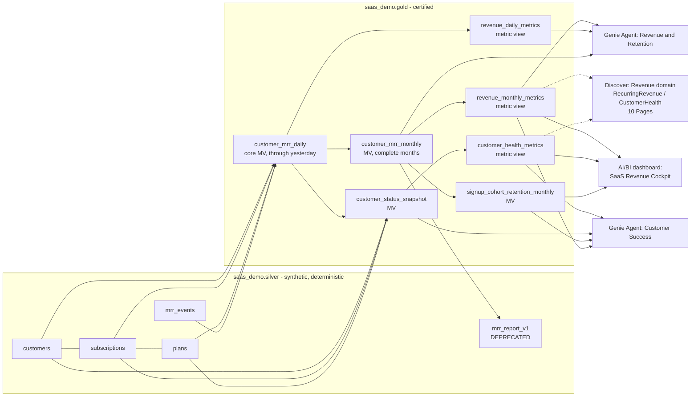

# Analytics (Demo | Example): Metric Views and Genie for SaaS Business Metrics

**SaaS business metrics - Unity Catalog metric views (semantic layer) + Genie Agents**

> **Features as of: 2026-Nov-22.** Built and validated on Azure Databricks, redeployed and re-validated on AWS Databricks on 2026-Nov-27, with the product features, names and syntax available on this date: Unity Catalog metric views (YAML v1.1, window measures), Genie Agents (benchmarks API), AI/BI dashboards, governed tags and certification, Discover domains and Pages (Beta). Later releases may change syntax, UI or product names.

An end-to-end, fully synthetic subscription (SaaS) analytics demo on Databricks that shows how a
**governed semantic layer** (Unity Catalog metric views) makes **Genie Agent** answers consistent and trustworthy,
and how **Discover** (domains, Pages, certification) helps business users find the right asset.

> All data is synthetic: fictional company names, no personal data, amounts in USD.

## The story in one paragraph

Finance and Customer Success both talk about "churn" and "revenue", but mean different things.
A legacy table (`silver.mrr_report_v1`) calls logo churn "churn". We define every KPI once, in certified
metric views (MRR is point-in-time and never summed across months; churn exists as logo and revenue churn),
deprecate the legacy table, publish business definitions as Discover Pages, and put two Genie Agents on top.
When a user asks an ambiguous question ("what's our churn?"), the Genie Agent asks which one or shows both,
instead of silently picking the wrong number.

## Architecture

## Repository layout

| Path | What it does |
| --- | --- |
| `sql/01_setup_catalog.sql` | Catalog `saas_demo`, schemas `silver`, `gold` |
| `sql/02_silver.sql` | Deterministic synthetic data (seed `saas_demo_v1`): an opening book of customers, 24 complete months before `current_date()`, plus the current month up to yesterday |
| `sql/03_gold_materialized_views.sql` | Core `customer_mrr_daily` plus three thin roll-ups: `customer_mrr_monthly`, `customer_status_snapshot`, `signup_cohort_retention_monthly` |
| `sql/04_metric_views.sql` | `revenue_monthly_metrics`, `customer_health_metrics`, `revenue_daily_metrics` (exported, YAML v1.1) |
| `sql/05_governance_tags.sql` | Domain tags and `system.certification_status` |
| `sql/06_legacy_mrr_report_v1.sql` | The deliberately misleading legacy table |
| `sql/07_validation.sql` | Row counts, MRR reconciliation, semiadditive check, realism check |
| `sql/08_column_comments.sql` | Business comments for every silver table and gold MV column (applied) |
| `genie/*.json` | Exact exported configuration of both Genie Agents |
| `dashboards/SaaS Revenue Cockpit.lvdash.json` | AI/BI dashboard on the certified metric views (created by the deploy script) |
| `scripts/deploy_governance_and_genie.py` | Creates governed tags, both Genie Agents and the AI/BI dashboard (Ask Genie pointed at the new Revenue and Retention agent), and their domain and certification tags, via REST |
| `scripts/rebuild_silver.py`, `sql/09_refresh_gold.sql`, `scripts/restore_metadata_and_validate.py` | Daily job `saas_business_metrics_daily_refresh` (3 tasks): rebuild silver (serverless), refresh gold MVs + legacy table (SQL warehouse), restore comments and tags + validate (serverless) |
| `docs/metric_dictionary.md` | Every dimension, measure and column of the 3 metric views, 4 gold MVs and 5 silver tables: definition, type (point-in-time, flow, rate), format and synonyms, plus which object answers which question |
| `docs/question_bank.md` | 20 validated business questions with SQL (6 deliberately ambiguous) |
| `docs/discover_setup.md` | Exact Discover domain, subdomain and Page content, with UI steps |

## Objects

### Silver (synthetic, reproducible)

Counts below cover the 24 complete months (through the end of the last complete month). The live tables also hold the current month to date, so they grow during the month: on 2026-11-27 they had 825 customers (800 + 25 current-month signups), 2,087 MRR events and 602 active / 223 churned subscriptions.

| Table | Rows | Grain / notes |
| --- | --- | --- |
| `customers` | 800 | 1 row per customer. SMB 435, Mid-Market 246, Enterprise 119. 305 opening-book customers (signed up in the 3 years before the window) + 495 new in the window. Unique fake names |
| `plans` | 5 | Starter, Pro (monthly/annual), Enterprise (annual) |
| `subscriptions` | 800 | 1 per customer; `end_date` NULL = active. 587 active, 213 churned at the end of the last complete month |
| `mrr_events` | 2,000 | new 800 (305 dated before the window = opening book, $502K MRR), expansion 712, contraction 275, churn 213 |
| `mrr_report_v1` | 72 | Legacy, deprecated: `churn` = logo churn only |

Simulation (per customer-month, hash-based randomness): monthly churn probability SMB 3.0% / Mid 1.7% / Ent 0.7%;
expansion 6% / 9% / 10% (+10-45%); contraction 3% (-5-25%); MRR between $100 and $12,000.
Opening-book customers start the window with their existing MRR (x1.2 maturity factor); their churn and expansion are simulated only inside the window.
A rebuild in the same calendar month reproduces the data exactly (the script is the one that built the live tables).

### Gold materialized views (serverless SQL warehouse)

One core fact and three thin roll-ups. The date rules live in two places only: the core covers the 24-month window
through **yesterday** (current month to date included), and the roll-ups keep **complete months** only.

| MV | Rows | Grain |
| --- | --- | --- |
| `customer_mrr_daily` | ~312K on 2026-11-27 (grows daily) | Core: customer x day the subscription was live, window start (or signup) through cancellation or yesterday. End-of-day `closing_mrr` (running total of MRR events), that day's movements and `recognized_revenue` (= MRR / days in the month). Opening-book MRR is the balance on the first window day |
| `customer_mrr_monthly` | 10,109 | Roll-up of the core: customer x complete month. `closing_mrr` = month-end balance, `opening = closing - (new + expansion - contraction - churned)` |
| `customer_status_snapshot` | 800 | Roll-up of the core: 1 row per customer as of the last complete month (current-month signups not yet included) |
| `signup_cohort_retention_monthly` | 300 | Roll-up of `customer_mrr_monthly`: signup_month x months_since_signup (24 in-window cohorts) |

### Metric views (semantic layer)

Full definitions of every dimension and measure (display names, formats, synonyms): [`docs/metric_dictionary.md`](docs/metric_dictionary.md).

`gold.revenue_monthly_metrics` (on `customer_mrr_monthly`) - dimensions `month`, `segment`, `region`, `plan`:

| Measure | Definition | Behaviour |
| --- | --- | --- |
| `mrr` | `SUM(closing_mrr)` | **Semiadditive** window measure (`order: month, range: current, semiadditive: last`): adds across segments, never across months |
| `arr` | `MEASURE(mrr) * 12` | Inherits point-in-time behaviour |
| `new_mrr`, `expansion_mrr`, `contraction_mrr`, `churned_mrr`, `net_new_mrr` | sums of movements | Flows, additive over months |
| `logo_churn_rate` | churned customers / opening customers | Monthly; pooled over several months |
| `gross_revenue_churn_rate` | (churned + contraction) / opening MRR | Monthly; pooled |
| `net_revenue_retention` | (opening + expansion - contraction - churned) / opening MRR | Excludes new; monthly |
| `opening_mrr_flow` | helper denominator | Hidden in the Genie Agents |
| `mrr_prev_month` | MRR one month earlier | Window `range: current`, `offset: -1 month`; point-in-time |
| `mrr_mom_growth` | (MRR - previous month) / previous month | Composed from window measures |
| `mrr_prior_year` | MRR same month last year | Window `offset: -1 year`; point-in-time |
| `mrr_yoy_growth` | (MRR - prior year) / prior year | Also the ARR growth rate |
| `net_new_mrr_t12m` | Net new MRR over the 12 months ending in the row month | Window `range: trailing 12 month inclusive` |
| `logo_churn_rate_t12m`, `gross_revenue_churn_rate_t12m`, `net_revenue_retention_t12m` | Pooled monthly rates over the trailing 12 months | Same window |
| `net_revenue_retention_annualized` | `POWER(net_revenue_retention_t12m, 12)` | Approximation of annual NRR, not cohort-based |
| `active_customers` | Paying customers at month end (`COUNT_IF(closing_mrr > 0)`) | **Semiadditive** like `mrr`: adds across segments, never across months |
| `new_customers`, `churned_customers`, `net_new_customers` | Signups inside the window, cancellations, and new - churned | Flows, additive over months; negative net new = shrinking by logos |
| `arpa` | `MEASURE(mrr) / MEASURE(active_customers)` | Month-end ARPA; point-in-time |

All time-comparison measures were validated against independent SQL on every month x segment row (2026). `trailing 12 month inclusive` = the row month plus the 11 before it (without `inclusive` the current month is excluded).

`gold.customer_health_metrics` (on `customer_status_snapshot`) - dimensions `segment`, `region`, `plan`, `status`;
measures `active_customers`, `avg_tenure_months`, `arpa`. Every dimension and measure has a comment, display name and synonyms; `avg_tenure_months` and `arpa` also have a format.

`gold.revenue_daily_metrics` (on `customer_mrr_daily`) - dimensions `date`, `month`, `segment`, `region`, `plan`; data through yesterday.
Daily and monthly trends come from grouping by `date` or `month`. Period-over-period comparisons are window measures, anchored on
the latest date in scope (yesterday) when no date is in the query:

| Measures | Definition |
| --- | --- |
| `recognized_revenue`, `net_new_mrr`, `new_mrr`, `expansion_mrr`, `contraction_mrr`, `churned_mrr`, `new_customers`, `churned_customers` | Flows, add up over any date range. Recognized revenue = each day earns MRR / days in that month |
| `mrr`, `active_customers` | End-of-day balances (semiadditive: never summed across days) |
| `recognized_revenue_l28d` / `_p28d`, `_l91d` / `_p91d` | Last 28 / 91 days (inclusive) vs the 28 / 91 days before |
| `recognized_revenue_mtd` / `_pmtd` | Month to date vs the same days of the previous month (day 1 to the same day number, capped at that month's end, e.g. Mar 1-31 vs Feb 1-28) |
| `recognized_revenue_l28d_change`, `_l91d_change`, `_mtd_change` | % change vs the prior period |
| `mrr_28d_ago`, `mrr_91d_ago`, `mrr_prev_month_same_day` and `mrr_change_28d`, `mrr_change_91d`, `mrr_change_mom_same_day` | MRR balance vs earlier dates, and % change |

Each window is its own measure (a metric view measure cannot take the period as a parameter), so every extra period or metric multiplies the count; the set is kept to the comparisons above.

### Governance and Discover

* Governed tags (account level): `Revenue`, `Revenue/RecurringRevenue`, `Revenue/CustomerHealth` (key-only).
* `Revenue/RecurringRevenue`: `customer_mrr_daily`, `customer_mrr_monthly`, `revenue_monthly_metrics`, `revenue_daily_metrics`, Genie Agent "Revenue and Retention", dashboard "SaaS Revenue Cockpit".
* `Revenue/CustomerHealth`: `customer_status_snapshot`, `signup_cohort_retention_monthly`, `customer_health_metrics`, Genie Agent "Customer Success", dashboard "SaaS Revenue Cockpit" (it spans both subdomains).
* Certified: all 7 gold objects (4 MVs, 3 metric views), both Genie Agents and the dashboard. Deprecated: `silver.mrr_report_v1` (with a deprecation comment pointing to the metric view).
* Discover: domain **Revenue** with subdomains **RecurringRevenue** and **CustomerHealth** (published).
* Pages (created as drafts, published after review; published on 2026-11-27): MRR, ARR, Revenue churn, Net revenue retention, MRR growth YoY, Annualized NRR (RecurringRevenue); Logo churn, ARPA, Active customer, Cohort retention (CustomerHealth), linked to the metric views and `signup_cohort_retention_monthly`.

Full Discover content (domain, subdomains, all 10 Pages with exact text): see [`docs/discover_setup.md`](docs/discover_setup.md).

Discover setup (UI; the domains API is Beta): Discover > Create domain > existing tag `Revenue` > subtitle/description > Create.
Open Revenue > Create subdomain > Use an existing tag > `Revenue/RecurringRevenue` (repeat for `Revenue/CustomerHealth`).
Note: creating a domain through the API published it immediately; set it back to draft if you want a review step.

Discover domains, subdomains and Pages are account-level objects: they survive when a workspace is deleted, so on a redeploy in the same account check for them before creating new ones. Page links to tables are scoped to a metastore, so after a redeploy on another metastore re-link each Page to its tables (Related assets) and remove the dead links in the UI (links cannot be listed through the API). Domain sections that feature Genie Agents or a dashboard must be updated to the new assets in the UI.

### Genie Agents (in the owner home folder, not shared)

| | Revenue and Retention | Customer Success |
| --- | --- | --- |
| Audience | Finance, RevOps | Customer success managers |
| Data | `revenue_monthly_metrics`, `revenue_daily_metrics` (daily trends, last 28 / 91 days, month to date), `customer_mrr_monthly` | `customer_health_metrics`, `customer_status_snapshot`, `signup_cohort_retention_monthly`, `revenue_monthly_metrics` (for NRR, revenue churn, shrinking segments) |
| Starter questions | What's our churn? / How is MRR growing MoM and YoY? / Which segments are shrinking? / MRR and ARR by segment / Annualized NRR by segment | Enterprise accounts churned in 6 months / 6-month cohort retention / Active customers and ARPA by segment / Tenure before churn / What's our retention? / Which segments are shrinking? |
| Example SQL | 10 (one with `:month` DATE, MoM/YoY growth, shrinking segments with both lenses, month to date, last 28 days by segment, daily trend) | 8 (one with `:segment` STRING; churn, retention and shrinking with both lenses) |
| SQL expressions | active customer, churned customer, enterprise segment, last complete month, quarter | active customer, churned customer (synonym attrition), enterprise segment, churned recently, tenure band, cohort logo retention |
| Benchmarks | 15 (incl. alternate phrasings, time comparisons, month to date, last 91 days and new / churned / net new customers by segment) | 12 (incl. alternate phrasings, NRR and churn) |
| Instruction structure | 10 sections: Role, Business context (segments, plans, regions, data window), Data sources, Daily data and period comparisons, Routing (which questions go to the other agent), Metric definitions, Time periods, Ambiguous questions, SQL guardrails, Answer style | The same sections without Daily data and period comparisons (9) |
| Key instructions | Churn without "logo" or "revenue" shows both rates; "shrinking" shows net new MRR and NRR over 3 months; never SUM MRR across months | Churn defaults to logo churn but shows both when unspecified; retention shows cohort retention and NRR; monthly rates use the last complete month |

### AI/BI dashboard: SaaS Revenue Cockpit

One page on the certified metric views (no measure is redefined in the dashboard):

* KPI counters: MRR (last complete month), ARR, MRR growth YoY, annualized NRR, logo churn (avg monthly, T12M), active customers.
* Charts: MRR by segment (stacked area), MRR movements per month (new / expansion / contraction / churned), annualized NRR by segment (100% reference line), logo vs revenue churn by segment, ARPA by segment, and a 12-month cohort retention curve (customers vs revenue retained).
* Datasets: `revenue_monthly_metrics` and `customer_health_metrics` imported as metric views, plus a dashboard-local metric view over `signup_cohort_retention_monthly`. The cohort curve stops at 12 months because later months have too few cohorts to be representative.
* Theme: one color-blind-safe palette with fixed meanings on every chart - segments (Enterprise deep blue, Mid-Market sky blue, SMB amber), revenue gained in blues, revenue lost in warm tones (amber, rose), never red next to green; neutral backgrounds in light and dark mode.
* Ask Genie uses the "Revenue and Retention" Genie Agent. Tagged `Revenue/RecurringRevenue` and `Revenue/CustomerHealth` and certified, so it appears in both Discover subdomains.

## Deploy (fresh workspace)

1. Serverless SQL warehouse; permissions: CREATE CATALOG (or an existing catalog), create governed tags, ASSIGN on those tags.
2. Run `sql/01` to `sql/04`, then `sql/06`, then `sql/05` (`05` tags `silver.mrr_report_v1`, which `06` creates). Run `02_silver.sql` in one session (or run `scripts/rebuild_silver.py` on serverless) and each metric view statement in `04` separately. Create the gold materialized views on the same SQL warehouse the daily job uses.
3. Run `sql/08_column_comments.sql`, then `sql/07_validation.sql` - all reconciliation checks must be 0.
4. Run `scripts/deploy_governance_and_genie.py` (set `WAREHOUSE_ID` and `PARENT_PATH`; the `PARENT_PATH` folder must exist). Governed tags that already exist in the account are skipped. It creates the governed tags, both Genie Agents and the SaaS Revenue Cockpit dashboard (as a draft, with Ask Genie pointed at the new Revenue and Retention agent), and tags all three with their subdomain and certification. Publish the dashboard after review.
5. Create the Discover domain/subdomains and Pages (UI), review, then publish. If they already exist in the account, re-link the Pages and update the domain sections instead (see Governance and Discover).
6. Keep the demo current with a daily Lakeflow Job `saas_business_metrics_daily_refresh` (git source = this repo on `main`, every day 06:00 UTC), 3 tasks in sequence:
   `rebuild_silver` (python file `scripts/rebuild_silver.py`, serverless) -> `refresh_gold` (SQL file `sql/09_refresh_gold.sql`,
   on the **SQL warehouse** that created the MVs - they cannot be refreshed from serverless generic compute) ->
   `restore_metadata_and_validate` (python file, serverless; fails the run if reconciliation breaks).
   Without it, daily figures stop at the last run, and questions about "the last complete month" return no data once the calendar month changes.

## Validation results (2026-11-17, after the P1 fixes)

* Reconciliation: 0 breaks at row and month level; opening = previous closing; final closing = sum of events; snapshot MRR = last-month MRR.
* Semiadditive MRR: current MRR = $1,313,240 (last month), never the sum of months. ARR $15.76M.
* Realism, trailing 12 months: logo churn 2.03%/month (SMB 2.78%, Mid 1.49%, Ent 0.75%); annualized NRR 105.4% (Ent 118.1%, Mid 102.1%, SMB 81.4%); YoY MRR growth +77%.
* Cross-view consistency: Enterprise ARPA ($6,098) x 105 active accounts = Enterprise MRR ($640,270).
* Metadata: all 10 objects have table comments; 78/78 columns commented (metric views via YAML).
* All 10 Genie Agent example queries run (parameters bound) and all 20 benchmark answers return rows.
* Genie Agent benchmarks: see "Benchmark history" below.

## Redeploy validation (2026-11-27, AWS workspace)

* Same numbers as on 2026-11-17: all `sql/07` reconciliation checks 0, MRR $1,313,240 (sum of all months would be $20.09M), logo churn 2.03%/month, annualized NRR 105.4% (Ent 118.1%, Mid 102.1%, SMB 81.4%), Enterprise ARPA $6,098 x 105 active accounts.
* Metadata: all 12 objects (5 silver tables, 4 gold MVs, 3 metric views) have table comments; 131/131 columns commented; 7 gold objects certified, `mrr_report_v1` deprecated.
* Daily job: test run succeeded in about 5 minutes (validation task: "Daily refresh OK").
* Genie Agent benchmarks: 14/14 and 12/12; live question "What's our MRR by segment?" matched the metric view.

## Benchmark history

| Run (2026-11-17) | Revenue and Retention | Customer Success | Notes |
| --- | --- | --- | --- |
| Baseline, 7 questions each | 5/7 | 6/7 | All 3 misses were benchmark-definition issues, not Genie Agent errors: an answer listed 4 regions for "which region added the most", a question did not state the 12-month period its answer used, an answer had an extra unrequested column |
| After fixes + 3 alternate phrasings each | 10/10 | 10/10 | Re-run after the opening-book data change |
| After time-comparison measures (+2 questions on Revenue) | 11/12, then 12/12 | - | YoY question reworded to "current ... latest month vs same month last year"; the Genie Agent had (reasonably) returned the 12-month YoY trend |
| After new starter questions + "shrinking" instruction (Revenue) | 12/12 | - | Starter questions also asked live via the Genie Agent API; "What's our churn?" showed both rates, "Which segments are shrinking?" showed both lenses |
| Restructured instructions (same 9 sections in both, business context, routing, SQL guardrails) | 12/12 | 12/12 | Key questions (churn, shrinking, retention, growth) also re-asked live with identical results |
| Simplified gold layer + new names + daily view (+2 benchmarks on Revenue) | 14/14 | 12/12 | All objects renamed (subject + grain), monthly numbers identical to before; "revenue month to date vs same days last month" and "last 28 vs prior 28 days by segment" asked live |
| Customer Success gets `revenue_monthly_metrics` (+2 benchmarks) | - | 12/12, then 11/12, then 12/12 | Live check caught "What's our churn?" reporting an all-months rate as current. A last-complete-month rule fixed it but made "churn over the last 12 months" group by month (11/12); rewording the rule (explicit period = one pooled rate per group) restored 12/12 |
| Redeploy on a new AWS workspace (2026-11-27) | 14/14 | 12/12 | Same Genie Agent configuration from `genie/*.json`, rebuilt data identical to 2026-11-17 |
| Customer-count measures added to `revenue_monthly_metrics` (2026-11-27) | 14/14 | 12/12 | Regression check: the existing questions do not use the new measures |
| + customer-count benchmark on Revenue (2026-11-27) | 1/1 (15 total) | - | "How many new, churned and net new customers did each segment have over the last 3 complete months?" (worded without "shrinking", which the agent answers with both revenue lenses) |

Lesson for the demo: benchmark answers must match the question exactly (row count, period, columns), otherwise correct Genie Agent answers are scored as wrong.

## Demo script (15 minutes)

1. **Discover**: open the Revenue domain; show certified vs deprecated assets and the "Logo churn" vs "Revenue churn" Pages.
2. **The trap**: query `silver.mrr_report_v1` - "churn" looks fine but hides revenue loss; note the deprecated badge.
3. **Semantic layer**: open `revenue_monthly_metrics` YAML; explain the semiadditive MRR. Run `sql/07` check 3.
4. **Genie Agent - Finance**: "What's our MRR by segment?", "What's our churn?" (the Genie Agent asks or shows both), "What is NRR by segment?".
5. **Genie Agent - Customer Success**: "Which Enterprise accounts churned recently?", "6-month retention by cohort".
6. **Insight**: "Which segments are shrinking?" - total MRR grows everywhere, but SMB NRR < 100%.
7. **Period over period**: "How is revenue this month so far compared with the same days last month?" and "Compare revenue in the last 28 days with the 28 days before, by segment" - answered from `revenue_daily_metrics` with ready-made window measures.
8. **Dashboard**: open the SaaS Revenue Cockpit - the same certified numbers as the Genie Agents, SMB below the 100% NRR line, and the cohort curve (customers fall to ~72% after 12 months while revenue stays near 100%). Use Ask Genie for a follow-up question.
9. **Trust**: show benchmarks and the certification badges.

## Known limitations

* Annualized NRR compounds the trailing-12-month monthly rate; a true cohort-based 12-month NRR would need a cohort fact.
* One plan per customer (expansion = seats); some Enterprise accounts sit at the $12,000 cap.
* Opening-book history before the window is collapsed into one 'new' event per customer.
* Cohort retention is not in a metric view, so the Customer Success agent queries that table directly.
* Discover Pages are created as drafts; publishing them is a deliberate review step.
* Gold MV column comments are lost on CREATE OR REPLACE: re-run `sql/08` after rebuilding (a column list with COMMENT in CREATE MATERIALIZED VIEW is ignored).

## Proposed improvements

### P1 - overall improvements
1. ~~Apply the column comments~~ - done (`sql/08`, applied with ALTER MATERIALIZED VIEW ... ALTER COLUMN).
2. ~~Certify `gold.customer_mrr_monthly` and comment `mrr_report_v1` as deprecated~~ - done.
3. ~~Run both Genie Agent benchmark sets~~ - done; 3 misses were benchmark-definition issues, fixed, alternate phrasings added (see Benchmark history).
4. ~~Add an opening customer base~~ - done: 305 customers with $502K MRR at window start; YoY growth now +77% instead of +169%.
5. ~~Delete the orphan `domain` governed tag~~ - done (no uses found).
6. ~~Publish the 10 Pages~~ - done (2026-11-27). **Open:** add both Genie Agents, the metric views and the dashboard to the domain page sections (UI).

### P2 - deepen the semantic layer
7. ~~**Time-intelligence measures**~~ - done: previous month, MoM %, prior year, YoY %, trailing-12-month net new MRR, churn and NRR, annualized NRR.
8. ~~**Customer counts over time** in the revenue metric view~~ - done (2026-11-27): `active_customers` (semiadditive), `new_customers`, `churned_customers`, `net_new_customers` and `arpa` by month, added with ALTER VIEW (tags kept). Validated on all 72 month x segment rows against `customer_mrr_monthly` (0 mismatches); active = previous active + new - churned for every row; last month matches `customer_health_metrics` (587 customers, Enterprise ARPA $6,098). In the last 3 months no segment shrinks by logos (net new: Enterprise +11, Mid-Market +15, SMB +8).
9. **Cohort metric view** on `signup_cohort_retention_monthly` (logo/revenue retention measures) so every Genie Agent answer goes through `MEASURE()`.
10. ~~**Synonyms in the metric view YAML**~~ - done: in `revenue_monthly_metrics` and `customer_health_metrics` every dimension and measure (except the hidden helper `opening_mrr_flow`) has synonyms in the YAML (in `revenue_daily_metrics` the six MRR comparison measures, `mrr_28d_ago` to `mrr_change_mom_same_day`, have none), shared by Genie Agents, dashboards and other tools. Bare "churn" / "attrition" are deliberately not synonyms, so the Genie Agents keep treating them as ambiguous.
11. **Billing-period and plan-change realism**: plan upgrades as a driver of expansion, annual vs monthly contracts.

### P3 - broaden the showcase
12. ~~**AI/BI dashboard** "Revenue cockpit" on the metric views, tagged into the domain~~ - done: "SaaS Revenue Cockpit" (see above).
13. **ABAC**: row filter by region using a governed tag, and a mask on `company_name`, to show governance flowing into the Genie Agents.
14. **Lineage walkthrough**: silver -> gold MV -> metric view -> Genie Agent/dashboard in Catalog Explorer.
15. **Data quality monitoring** on the gold MVs (freshness, reconciliation as an alert).
16. **Packaging as a Declarative Automation Bundle** (SQL tasks + daily refresh job + Genie Agent deployment) with the catalog name as a variable, so the demo can be stood up per customer in minutes.
17. **Cross-agent experience**: ~~add the revenue metric view to the Customer Success agent~~ (done, 4 objects); next, expose both agents through Genie One so ambiguous retention questions can be answered in one place.

## References (official Databricks on AWS documentation)

Metric views (semantic layer):
* [Unity Catalog metric views](https://docs.databricks.com/aws/en/uc-semantics/metric-views/index/) - overview
* [Create a metric view](https://docs.databricks.com/aws/en/uc-semantics/metric-views/create/) - Catalog Explorer editor, display names, synonyms, formats
* [Metric view YAML syntax reference](https://docs.databricks.com/aws/en/uc-semantics/metric-views/yaml-reference/) - fields, measures, formats, `MEASURE()`
* [Advanced techniques for metric views](https://docs.databricks.com/aws/en/uc-semantics/metric-views/advanced-techniques/) - window measures (semiadditive, trailing, offset) and composability, as used for `mrr`, `active_customers` and the period comparisons
* [Manage metric views](https://docs.databricks.com/aws/en/uc-semantics/metric-views/manage/)

Gold layer and refresh:
* [CREATE MATERIALIZED VIEW](https://docs.databricks.com/aws/en/sql/language-manual/sql-ref-syntax-ddl-create-materialized-view/) - Pro or serverless SQL warehouse required
* [REFRESH (MATERIALIZED VIEW or STREAMING TABLE)](https://docs.databricks.com/aws/en/sql/language-manual/sql-ref-syntax-ddl-refresh-full/)
* [Lakeflow Jobs](https://docs.databricks.com/aws/en/jobs/index/) and [Run your Lakeflow Jobs with serverless compute](https://docs.databricks.com/aws/en/jobs/run-serverless-jobs/) - the daily refresh job

Genie Agents:
* [Curate an effective Genie Agent](https://docs.databricks.com/aws/en/genie-agents/best-practices/)
* [Tune Genie Agent quality](https://docs.databricks.com/aws/en/genie-agents/tune-quality/) - example SQL, instructions, SQL expressions, limits
* [Test and monitor a Genie Agent](https://docs.databricks.com/aws/en/genie-agents/monitor/) - benchmarks
* [Use the Genie Agents API](https://docs.databricks.com/aws/en/genie-agents/conversation-api/) - `serialized_space` format used by `genie/*.json` and the deploy script

AI/BI dashboards:
* [Dashboard concepts](https://docs.databricks.com/aws/en/dashboards/concepts/)
* [Genie Agents with dashboards](https://docs.databricks.com/aws/en/dashboards/genie-spaces/) - Ask Genie

Governance and Discover:
* [Governed tags](https://docs.databricks.com/aws/en/admin/governed-tags/index/)
* [Flag data as certified or deprecated](https://docs.databricks.com/aws/en/data-governance/unity-catalog/certify-deprecate-data/) - `system.certification_status`
* [Domains and subdomains](https://docs.databricks.com/aws/en/uc-semantics/domains/)
* [Pages](https://docs.databricks.com/aws/en/uc-semantics/pages/) - create, publish, certify
* [Discover page](https://docs.databricks.com/aws/en/discover/discover-page/) - curator, Page manager and consumer personas
* [Organize assets with domains, subdomains, and Pages](https://docs.databricks.com/aws/en/getting-started/starter-journey/genie-ontology/domains-subdomains-pages/) - step-by-step tutorial
* [Lineage in Unity Catalog](https://docs.databricks.com/aws/en/data-governance/unity-catalog/data-lineage/) - for the lineage walkthrough (P3 #14)

Source control:
* [Databricks Git folders](https://docs.databricks.com/aws/en/repos/index/)
