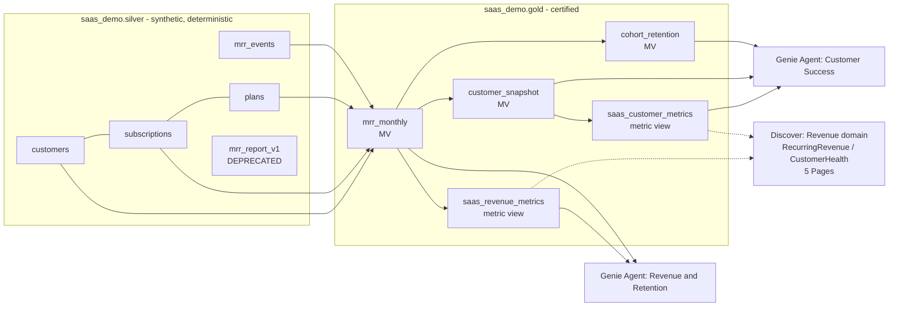

# analytics__metric_views_genie__saas_business_metrics

**SaaS business metrics - Unity Catalog metric views (semantic layer) + Genie Agents**

> **Features as of: 2026-Nov-18.** Built and validated on Azure Databricks with the product features, names and syntax available on this date: Unity Catalog metric views (YAML v1.1, window measures), Genie Agents (benchmarks API), governed tags and certification, Discover domains and Pages (Beta). Later releases may change syntax, UI or product names.

An end-to-end, fully synthetic subscription (SaaS) analytics demo on Azure Databricks that shows how a
**governed semantic layer** (Unity Catalog metric views) makes **Genie Agent** answers consistent and trustworthy,
and how **Discover** (domains, Pages, certification) helps business users find the right asset.

> All data is synthetic: fictional company names, no personal data, amounts in USD.

## The story in one paragraph

Finance and Customer Success both talk about "churn" and "revenue", but mean different things.
A legacy table (`silver.mrr_report_v1`) calls logo churn "churn". We define every KPI once, in certified
metric views (MRR is point-in-time and never summed across months; churn exists as logo and revenue churn),
deprecate the legacy table, publish business definitions as Discover Pages, and put two Genie Agents on top.
When a user asks an ambiguous question ("what's our churn?"), the Genie Agent asks which one or shows both,
instead of silently picking the wrong number.

## Architecture

## Repository layout

| Path | What it does |
| --- | --- |
| `sql/01_setup_catalog.sql` | Catalog `saas_demo`, schemas `silver`, `gold` |
| `sql/02_silver.sql` | Deterministic synthetic data (seed `saas_demo_v1`): an opening book of customers plus 24 complete months before `current_date()` |
| `sql/03_gold_materialized_views.sql` | `mrr_monthly`, `customer_snapshot`, `cohort_retention` (exported from the live workspace) |
| `sql/04_metric_views.sql` | `saas_revenue_metrics`, `saas_customer_metrics` (exported, YAML v1.1) |
| `sql/05_governance_tags.sql` | Domain tags and `system.certification_status` |
| `sql/06_legacy_mrr_report_v1.sql` | The deliberately misleading legacy table |
| `sql/07_validation.sql` | Row counts, MRR reconciliation, semiadditive check, realism check |
| `sql/08_column_comments.sql` | Business comments for every silver table and gold MV column (applied) |
| `genie/*.json` | Exact exported configuration of both Genie Agents |
| `scripts/deploy_governance_and_genie.py` | Creates governed tags, Genie Agents and their tags via REST |
| `scripts/monthly_refresh.py` | Monthly job: rebuilds silver, refreshes gold MVs, restores comments and tags, validates |
| `docs/question_bank.md` | 20 validated business questions with SQL (6 deliberately ambiguous) |
| `docs/discover_setup.md` | Exact Discover domain, subdomain and Page content, with UI steps |

## Objects

### Silver (synthetic, reproducible)

| Table | Rows | Grain / notes |
| --- | --- | --- |
| `customers` | 800 | 1 row per customer. SMB 435, Mid-Market 246, Enterprise 119. 305 opening-book customers (signed up in the 3 years before the window) + 495 new in the window. Unique fake names |
| `plans` | 5 | Starter, Pro (monthly/annual), Enterprise (annual) |
| `subscriptions` | 800 | 1 per customer; `end_date` NULL = active. 587 active, 213 churned |
| `mrr_events` | 2,000 | new 800 (305 dated before the window = opening book, $502K MRR), expansion 712, contraction 275, churn 213 |
| `mrr_report_v1` | 72 | Legacy, deprecated: `churn` = logo churn only |

Simulation (per customer-month, hash-based randomness): monthly churn probability SMB 3.0% / Mid 1.7% / Ent 0.7%;
expansion 6% / 9% / 10% (+10-45%); contraction 3% (-5-25%); MRR between $100 and $12,000.
Opening-book customers start the window with their existing MRR (x1.2 maturity factor); their churn and expansion are simulated only inside the window.
A rebuild in the same calendar month reproduces the data exactly (the script is the one that built the live tables).

### Gold materialized views (serverless SQL warehouse)

| MV | Rows | Grain |
| --- | --- | --- |
| `mrr_monthly` | 10,109 | customer x month, first window month (or signup month) to churn month. Opening-book MRR becomes the opening MRR of the first window month. `closing = opening + new + expansion - contraction - churned` |
| `customer_snapshot` | 800 | 1 row per customer as of the last complete month |
| `cohort_retention` | 300 | signup_month x months_since_signup (24 in-window cohorts) |

### Metric views (semantic layer)

`gold.saas_revenue_metrics` (on `mrr_monthly`) - dimensions `month`, `segment`, `region`, `plan`:

| Measure | Definition | Behaviour |
| --- | --- | --- |
| `mrr` | `SUM(closing_mrr)` | **Semiadditive** window measure (`order: month, range: current, semiadditive: last`): adds across segments, never across months |
| `arr` | `MEASURE(mrr) * 12` | Inherits point-in-time behaviour |
| `new_mrr`, `expansion_mrr`, `contraction_mrr`, `churned_mrr`, `net_new_mrr` | sums of movements | Flows, additive over months |
| `logo_churn_rate` | churned customers / opening customers | Monthly; pooled over several months |
| `gross_revenue_churn_rate` | (churned + contraction) / opening MRR | Monthly; pooled |
| `net_revenue_retention` | (opening + expansion - contraction - churned) / opening MRR | Excludes new; monthly |
| `opening_mrr_flow` | helper denominator | Hidden in the Genie Agents |
| `mrr_prev_month` | MRR one month earlier | Window `range: current`, `offset: -1 month`; point-in-time |
| `mrr_mom_growth` | (MRR - previous month) / previous month | Composed from window measures |
| `mrr_prior_year` | MRR same month last year | Window `offset: -1 year`; point-in-time |
| `mrr_yoy_growth` | (MRR - prior year) / prior year | Also the ARR growth rate |
| `net_new_mrr_t12m` | Net new MRR over the 12 months ending in the row month | Window `range: trailing 12 month inclusive` |
| `logo_churn_rate_t12m`, `gross_revenue_churn_rate_t12m`, `net_revenue_retention_t12m` | Pooled monthly rates over the trailing 12 months | Same window |
| `net_revenue_retention_annualized` | `POWER(net_revenue_retention_t12m, 12)` | Approximation of annual NRR, not cohort-based |

All time-comparison measures were validated against independent SQL on every month x segment row (2026). `trailing 12 month inclusive` = the row month plus the 11 before it (without `inclusive` the current month is excluded).

`gold.saas_customer_metrics` (on `customer_snapshot`) - dimensions `segment`, `region`, `plan`, `status`;
measures `active_customers`, `avg_tenure_months`, `arpa`. Every dimension and measure has a comment, display name and format.

### Governance and Discover

* Governed tags (account level): `Revenue`, `Revenue/RecurringRevenue`, `Revenue/CustomerHealth` (key-only).
* `Revenue/RecurringRevenue`: `mrr_monthly`, `saas_revenue_metrics`, Genie Agent "Revenue and Retention".
* `Revenue/CustomerHealth`: `customer_snapshot`, `cohort_retention`, `saas_customer_metrics`, Genie Agent "Customer Success".
* Certified: all 5 gold objects + both Genie Agents. Deprecated: `silver.mrr_report_v1` (with a deprecation comment pointing to the metric view).
* Discover: domain **Revenue** with subdomains **RecurringRevenue** and **CustomerHealth** - all **draft**.
* Pages (draft): MRR, ARR, Revenue churn, Net revenue retention (RecurringRevenue); Logo churn (CustomerHealth), linked to the metric views.

Full Discover content (domain, subdomains, all 5 Pages with exact text): see [`docs/discover_setup.md`](docs/discover_setup.md).

Discover setup (UI; the domains API is Beta): Discover > Create domain > existing tag `Revenue` > subtitle/description > Create.
Open Revenue > Create subdomain > Use an existing tag > `Revenue/RecurringRevenue` (repeat for `Revenue/CustomerHealth`).
Note: creating a domain through the API published it immediately; set it back to draft if you want a review step.

### Genie Agents (in the owner home folder, not shared)

| | Revenue and Retention | Customer Success |
| --- | --- | --- |
| Audience | Finance, RevOps | Customer success managers |
| Data | `saas_revenue_metrics`, `mrr_monthly` | `saas_customer_metrics`, `customer_snapshot`, `cohort_retention` |
| Example SQL | 6 (one with `:month` DATE, one MoM/YoY growth) | 5 (one with `:segment` STRING) |
| SQL expressions | active customer, churned customer, enterprise segment, last complete month, quarter | active customer, churned customer (synonym attrition), enterprise segment, churned recently, tenure band, cohort logo retention |
| Benchmarks | 12 (incl. alternate phrasings and time comparisons) | 10 (incl. alternate phrasings) |
| Key instruction | "When asked about churn without saying logo or revenue, ask which one, or show both." | Churn here = logo churn; revenue questions go to the other agent |

## Deploy (fresh workspace)

1. Serverless SQL warehouse; permissions: CREATE CATALOG (or an existing catalog), create governed tags, ASSIGN on those tags.
2. Run `sql/01` to `sql/06` in order (run `02_silver.sql` in one session; run each metric view statement in `04` separately).
3. Run `sql/08_column_comments.sql`, then `sql/07_validation.sql` - all reconciliation checks must be 0.
4. Run `scripts/deploy_governance_and_genie.py` (set `WAREHOUSE_ID` and `PARENT_PATH`).
5. Create the Discover domain/subdomains and Pages (UI), review, then publish.
6. Keep the demo current: schedule `scripts/monthly_refresh.py` as a Lakeflow Job (serverless python file task,
   git source = this repo on `main`) on the 1st of each month. Without it, questions about "the last complete month"
   return no data once the calendar month changes, because silver is a snapshot built for one window.

## Validation results (2026-11-17, after the P1 fixes)

* Reconciliation: 0 breaks at row and month level; opening = previous closing; final closing = sum of events; snapshot MRR = last-month MRR.
* Semiadditive MRR: current MRR = $1,313,240 (last month), never the sum of months. ARR $15.76M.
* Realism, trailing 12 months: logo churn 2.03%/month (SMB 2.78%, Mid 1.49%, Ent 0.75%); annualized NRR 105.4% (Ent 118.1%, Mid 102.1%, SMB 81.4%); YoY MRR growth +77%.
* Cross-view consistency: Enterprise ARPA ($6,098) x 105 active accounts = Enterprise MRR ($640,270).
* Metadata: all 10 objects have table comments; 78/78 columns commented (metric views via YAML).
* All 10 Genie Agent example queries run (parameters bound) and all 20 benchmark answers return rows.
* Genie Agent benchmarks: see "Benchmark history" below.

## Benchmark history

| Run (2026-11-17) | Revenue and Retention | Customer Success | Notes |
| --- | --- | --- | --- |
| Baseline, 7 questions each | 5/7 | 6/7 | All 3 misses were benchmark-definition issues, not Genie Agent errors: an answer listed 4 regions for "which region added the most", a question did not state the 12-month period its answer used, an answer had an extra unrequested column |
| After fixes + 3 alternate phrasings each | 10/10 | 10/10 | Re-run after the opening-book data change |
| After time-comparison measures (+2 questions on Revenue) | 11/12, then 12/12 | - | YoY question reworded to "current ... latest month vs same month last year"; the Genie Agent had (reasonably) returned the 12-month YoY trend |

Lesson for the demo: benchmark answers must match the question exactly (row count, period, columns), otherwise correct Genie Agent answers are scored as wrong.

## Demo script (15 minutes)

1. **Discover**: open the Revenue domain; show certified vs deprecated assets and the "Logo churn" vs "Revenue churn" Pages.
2. **The trap**: query `silver.mrr_report_v1` - "churn" looks fine but hides revenue loss; note the deprecated badge.
3. **Semantic layer**: open `saas_revenue_metrics` YAML; explain the semiadditive MRR. Run `sql/07` check 3.
4. **Genie Agent - Finance**: "What's our MRR by segment?", "What's our churn?" (the Genie Agent asks or shows both), "What is NRR by segment?".
5. **Genie Agent - Customer Success**: "Which Enterprise accounts churned recently?", "6-month retention by cohort".
6. **Insight**: "Which segments are shrinking?" - total MRR grows everywhere, but SMB NRR < 100%.
7. **Trust**: show benchmarks and the certification badges.

## Known limitations

* Annualized NRR compounds the trailing-12-month monthly rate; a true cohort-based 12-month NRR would need a cohort fact.
* One plan per customer (expansion = seats); some Enterprise accounts sit at the $12,000 cap.
* Opening-book history before the window is collapsed into one 'new' event per customer.
* Cohort retention is not in a metric view, so the Customer Success agent queries that table directly.
* Discover domain, subdomains and Pages are still drafts (publishing is a deliberate review step).
* Gold MV column comments are lost on CREATE OR REPLACE: re-run `sql/08` after rebuilding (a column list with COMMENT in CREATE MATERIALIZED VIEW is ignored).

## Proposed improvements

### P1 - before showing the customer (status 2026-11-17)
1. ~~Apply the column comments~~ - done (`sql/08`, applied with ALTER MATERIALIZED VIEW ... ALTER COLUMN).
2. ~~Certify `gold.mrr_monthly` and comment `mrr_report_v1` as deprecated~~ - done.
3. ~~Run both Genie Agent benchmark sets~~ - done; 3 misses were benchmark-definition issues, fixed, alternate phrasings added (see Benchmark history).
4. ~~Add an opening customer base~~ - done: 305 customers with $502K MRR at window start; YoY growth now +77% instead of +169%.
5. ~~Delete the orphan `domain` governed tag~~ - done (no uses found).
6. **Open:** review and publish the domain, subdomains and Pages; add both Genie Agents and the metric views to the domain page sections (UI).

### P2 - deepen the semantic layer
7. ~~**Time-intelligence measures**~~ - done: previous month, MoM %, prior year, YoY %, trailing-12-month net new MRR, churn and NRR, annualized NRR.
8. **Customer counts over time** in the revenue metric view (`active_customers` semiadditive, `new_customers`, `churned_customers`, ARPA by month) to answer "which segments are shrinking by logos".
9. **Cohort metric view** on `cohort_retention` (logo/revenue retention measures) so every Genie Agent answer goes through `MEASURE()`.
10. **Synonyms in the metric view YAML** (not only in the Genie Agents) so dashboards, Genie Agents and other tools share one vocabulary.
11. **Billing-period and plan-change realism**: plan upgrades as a driver of expansion, annual vs monthly contracts.

### P3 - broaden the showcase
12. **AI/BI dashboard** "Revenue cockpit" on the metric views, tagged into the domain.
13. **ABAC**: row filter by region using a governed tag, and a mask on `company_name`, to show governance flowing into the Genie Agents.
14. **Lineage walkthrough**: silver -> gold MV -> metric view -> Genie Agent/dashboard in Catalog Explorer.
15. **Data quality monitoring** on the gold MVs (freshness, reconciliation as an alert).
16. **Packaging as a Declarative Automation Bundle** (SQL tasks + monthly refresh job + Genie Agent deployment) with the catalog name as a variable, so the demo can be stood up per customer in minutes.
17. **Cross-agent experience**: add the revenue metric view to the Customer Success agent (still <= 5 objects) or expose both agents through Genie One so ambiguous retention questions can be answered in one place.
