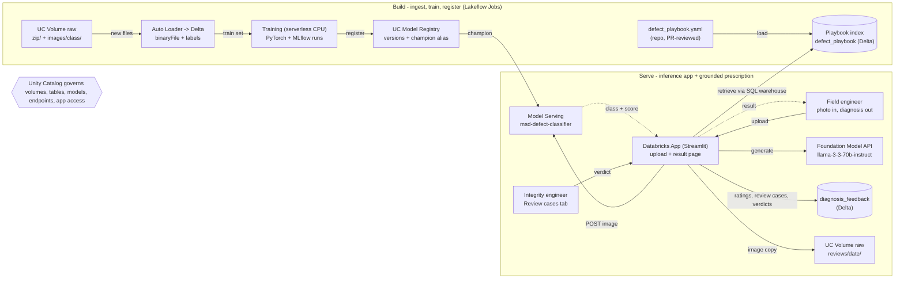
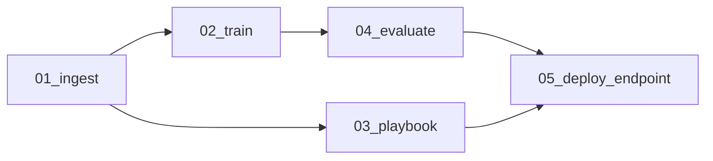
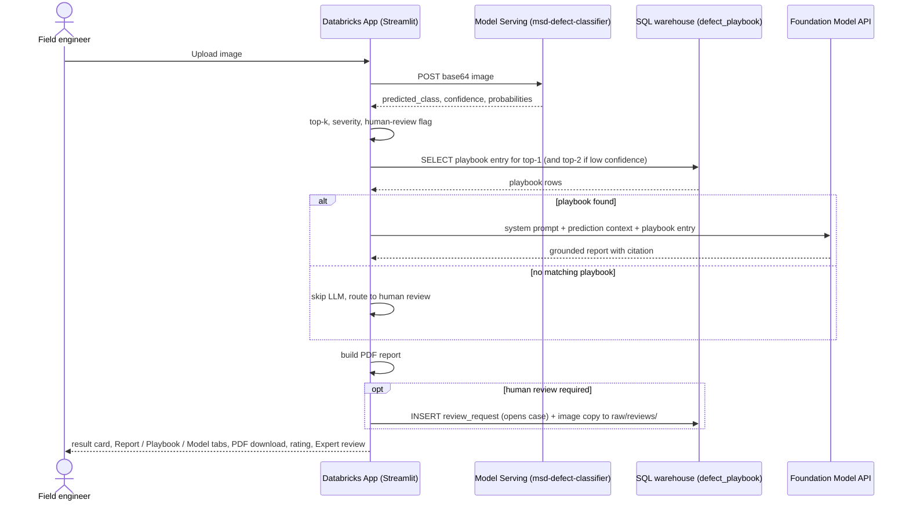
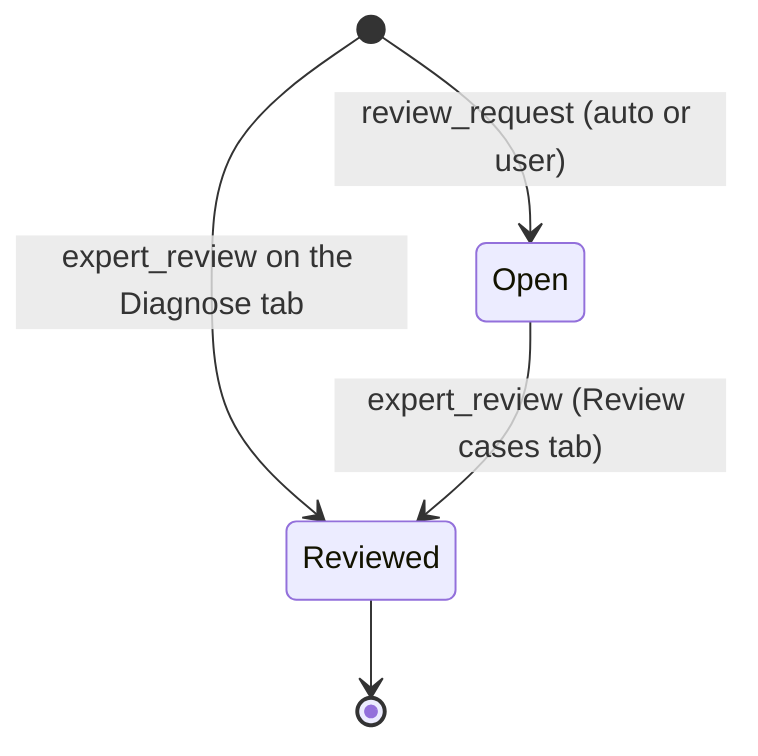
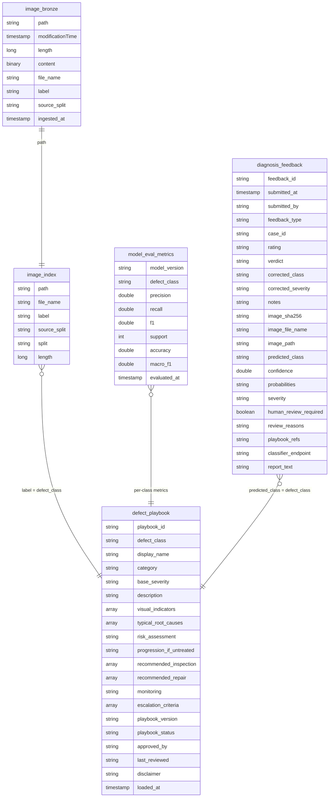

# Metal Surface Defect Diagnostics - System Architecture

This document explains how the solution and the codebase are structured: components, data flows,
data model, configuration, security and how to extend it. For setup and usage see `README.md`;
for scope and phases see `PLAN.md`; for history see `CHANGELOG.md`.

## 1. Overview

The solution follows the reference architecture **"Pipe corrosion image diagnostics"** on Azure
Databricks (serverless). It has two planes, both governed by Unity Catalog:

* **Build plane** (Lakeflow Jobs): ingest labelled images, train and register an image classifier,
  load the SME playbook index, evaluate, and publish the model to Model Serving.
* **Serve plane** (Databricks App): a field engineer uploads a photo, the app gets the predicted
  defect class and confidence from Model Serving, retrieves the matching playbook entry, and a
  Foundation Model writes a grounded prescription from that entry. The result can be downloaded
  as a PDF; unconfirmed results open an expert review case that an integrity engineer closes
  with a verdict (human in the loop).

Design principle: **playbooks are written up front with integrity engineers; the LLM only
rephrases what it retrieves**, cites the source entry, and flags low confidence or no matching
playbook for human review.

## 2. System context



Legend (as in the reference): governed assets are the volume, tables, model, endpoint and app;
compute steps are the job tasks, Model Serving and the LLM; stored data is the volume and Delta
tables; people/input is the field engineer. Solid arrows are calls, dotted arrows are responses.

## 3. Components

| Component | Databricks service | Bundle resource / code | Responsibility |
| --- | --- | --- | --- |
| Raw volume | UC managed volume | `resources/msd.volume.yml` | Holds the uploaded NEU zip (`zip/`) and extracted images (`images/<class>/`) |
| Schema | UC schema | `resources/msd.schema.yml` | Container for all tables, the volume and the registered model |
| Ingest | Lakeflow Job task, serverless | `src/pipeline/01_ingest.ipynb` | Extract zip, Auto Loader `binaryFile` into `image_bronze`, label from folder name, stratified split into `image_index` |
| Train | Lakeflow Job task, serverless CPU | `src/pipeline/02_train.ipynb` | Transfer learning (MobileNetV3-Small), MLflow tracking, pyfunc packaging, isolated serving-readiness check, register a new UC model version |
| Experiment | MLflow experiment | `resources/msd.experiment.yml` | One experiment per target; training runs and evaluation artifacts |
| Playbook load | Lakeflow Job task | `src/pipeline/03_playbook.ipynb`, `src/playbook/defect_playbook.yaml` | Validate the YAML and overwrite the `defect_playbook` Delta table; create `diagnosis_feedback` if missing (never overwritten) |
| Evaluate | Lakeflow Job task | `src/pipeline/04_evaluate.ipynb` | Test-set accuracy, per-class metrics, confusion matrix; append `model_eval_metrics`; promotion gate sets the `champion` alias |
| Deploy endpoint | Lakeflow Job task | `src/pipeline/05_deploy_endpoint.ipynb` | Create or update the serving endpoint pinned to the exact `champion` version; wait for READY; smoke test |
| Classifier endpoint | Model Serving (CPU, Small, scale-to-zero) | created by task 05 | REST inference: base64 image in; `predicted_class`, `confidence`, `probabilities` out. `msd-defect-classifier` (prod), `msd-defect-classifier-dev` (dev) |
| Web app | Databricks Apps (Streamlit) | `resources/msd_app.app.yml`, `src/app/` | Mobile-first UI: one image per analysis, result card, report / playbook / model tabs, PDF download, rating, expert review cases |
| Playbook index | Delta table via SQL warehouse | `defect_playbook` | Retrieval of the SME entry for the predicted class |
| Feedback store | Delta table via SQL warehouse + UC volume | `diagnosis_feedback` (created by `03_playbook`), `raw/reviews/` | Ratings, review requests (open cases) and expert reviews, with a copy of the reviewed image |
| LLM | Foundation Model API (pay-per-token) | `databricks-meta-llama-3-3-70b-instruct` | Rephrase the retrieved playbook entry into the diagnostic report |

## 4. Build plane

### 4.1 Job DAG



One job (`msd_training`, `resources/msd_training.job.yml`) runs the whole build on serverless
compute, with a 2-hour job timeout and one concurrent run. Tasks are parameterised from bundle
variables (catalog, schema, volume, model name, experiment, epochs, promotion gate, endpoint
name), so the same code runs in `dev` and `prod`. `train` passes the exact registered version to
`evaluate` through a task value.

Typical end-to-end run in dev: about 21 minutes. `ingest` takes about 2 minutes (no new files),
`playbook` 1, `train` 7 (about 4 of them training), `evaluate` 1, and `deploy_endpoint` about 11
when a new version is promoted (Model Serving builds and rolls out the model container). When
the endpoint already serves the `champion` version, the deploy task finishes in seconds.

### 4.2 Ingestion

1. The user uploads the Kaggle zip, unchanged, to `/Volumes/<catalog>/<schema>/raw/` (root or
   `zip/`). Every `*.zip` found there is processed.
2. `01_ingest` extracts the images (not the XML annotations) from
   `NEU-DET/<split>/images/<class>/` to
   `/Volumes/<catalog>/<schema>/raw/images/<source_split>/<class>/<file>.jpg`. Files already
   present with the same size are skipped.
3. Auto Loader (`cloudFiles.format = binaryFile`, `availableNow` trigger, checkpoint in
   `raw/_checkpoints/image_bronze`) appends new images to `image_bronze`; `label` is the parent
   folder and `source_split` the grandparent folder. Re-runs only pick up new files.
4. `image_index` is rebuilt each run with a deterministic split that keeps the dataset's
   published split: Kaggle `train` (240 per class) -> `train`; Kaggle `validation` (60 per class)
   -> 30 `val` + 30 `test` per class, ordered by `xxhash64(file_name)`.
5. Checks fail the task on unexpected classes, duplicate paths or an empty split.

### 4.3 Training and registration

* Backbone: torchvision MobileNetV3-Small pretrained on ImageNet; classifier head replaced with 6
  outputs; grayscale images replicated to 3 channels, resized to 224x224, ImageNet normalisation,
  augmentation with horizontal and vertical flips.
* Optimisation: AdamW (lr 3e-4, weight decay 1e-4), cosine learning-rate schedule, 8 epochs
  (`train_epochs`), batch 32, seed 42. The checkpoint with the best validation accuracy is kept.
  On serverless CPU an epoch takes about 30 seconds with PyTorch's default thread count. Switching
  to serverless GPU only changes the task compute.
* Dependencies: CPU PyTorch 2.5.1 / torchvision 0.20.1 from the PyTorch CPU index, installed
  with `%pip` in the task. The model's serving requirements pin `torch==2.5.1` and
  `torchvision==0.20.1` without a `+cpu` tag, because that build exists only for x86_64 while
  serverless can schedule the task on aarch64.
* Packaging: MLflow pyfunc wrapper (weights and class list as artifacts). Input: DataFrame column
  `image` with base64-encoded image bytes. Output: `predicted_class`, `confidence` (top-1
  probability) and `probabilities` (JSON string class -> probability). Signature and input
  example are logged.
* Serving-readiness gate: before registration, the logged artifact is loaded and scored with
  `mlflow.models.predict(..., env_manager="uv")`, which installs the declared requirements from
  scratch in an isolated environment, as Model Serving will.
* Registration: a new version of `<catalog>.<schema>.msd_defect_classifier` in Unity Catalog. The
  `champion` alias is set later by `04_evaluate`.

### 4.4 Evaluation and promotion

* `04_evaluate` loads the exact version from Unity Catalog and scores the held-out `test` split
  (30 images per class) through the same pyfunc interface the endpoint uses.
* It computes accuracy, macro F1, per-class precision/recall/F1/support and the confusion matrix.
  Metrics and CSV artifacts (`evaluation/confusion_matrix.csv`,
  `evaluation/per_class_metrics.csv`) are logged to the version's MLflow run, and one row per
  class is appended to `model_eval_metrics`.
* Gate: the version gets the `champion` alias (and a `test_accuracy` version tag) only if test
  accuracy >= `min_test_accuracy` (default 0.90). Otherwise the previous champion stays.
* Current dev result: 98.33% test accuracy (177/180), macro F1 0.984. The three errors are two
  `inclusion` images and one `patches` image predicted as `pitted_surface`; two test images
  score below the 0.70 confidence threshold and would be routed to human review.

### 4.5 Endpoint deployment

* `05_deploy_endpoint` resolves `champion` to an exact version and never serves "latest".
* It checks that the workspace supports `CPU` / `Small`, creates the endpoint if absent, or
  updates it when the served version differs. It refuses to modify an endpoint that serves a
  different model.
* Settings: `CPU` workload (4 GB per concurrency), `Small` size (4 concurrent requests),
  scale-to-zero enabled (the first request after idle has a cold start). No route optimisation.
* It waits for `READY` (fails on `UPDATE_FAILED` / `UPDATE_CANCELED`, times out after 45 minutes),
  then smoke-tests one test image per class and requires at least 5 of 6 correct.
* The endpoint name is workspace-global and not prefixed by development mode, so the `dev`
  target overrides it to `msd-defect-classifier-dev`.

### 4.6 Playbook index

`src/playbook/defect_playbook.yaml` is the source of truth (v1.0.0, status `draft`, pending SME
review). `03_playbook` validates it (exactly the six NEU classes, unique `playbook_id`, required
text and list fields non-empty, `base_severity` in Low/Medium/High) and overwrites
`defect_playbook`; validation errors fail the task so an invalid playbook never reaches the app. Content changes go through a pull request and a CHANGELOG entry.

## 5. Serve plane

### 5.1 Inference sequence



Nothing is sent until the user presses **Analyze image**; one image per analysis. The result is
kept in the Streamlit session, so tab clicks and widget changes do not call the endpoints again.
**New analysis** clears it.

### 5.2 Severity and human review

| Condition | Severity | Human review |
| --- | --- | --- |
| top-1 confidence < threshold (default 0.70) | Low (unconfirmed) | Yes; report covers top-2 classes |
| confidence >= threshold | class base weight (Low / Medium / High) | No |
| confidence >= 0.95 and base weight High | Critical | No |
| no playbook entry or lookup failure | as above | Yes; LLM not called |

Base weights per class are in the playbook (`base_severity`), so they are reviewed together with
the content.

### 5.3 Grounded generation

* The system prompt restricts the model to the provided playbook entry, requires the fixed
  sections (Defect Summary, Risk Assessment, Recommended Inspection, Recommended Repair,
  Monitoring and Escalation) and a final `Source: <playbook_id> v<playbook_version>` line.
* The user prompt carries the prediction context (class, category, confidence, severity, review
  flag) and the playbook entry as structured text.
* Low temperature, bounded `max_tokens`. If the LLM call fails, the app shows the playbook entry
  directly so the user always gets the reviewed baseline.

### 5.4 App modules

| Module | Purpose |
| --- | --- |
| `app.py` | Streamlit UI: Diagnose and Review cases tabs, phone-width layout (480 px column, app bar, cards), upload or camera input, result card, Report / Playbook / Model tabs, actions |
| `lib/classifier_client.py` | Calls the serving endpoint with the Databricks SDK |
| `lib/severity.py` | Pure functions for severity and human-review rules (unit-testable) |
| `lib/playbook.py` | Shared SQL helper (`run_statement`, waits for warehouse start), table-name validation, `defect_playbook` lookup |
| `lib/prompt.py` | System and user prompts, source line, heading normalisation, playbook entry as Markdown |
| `lib/llm_client.py` | Calls the Foundation Model API (chat) |
| `lib/report_pdf.py` | Builds the downloadable PDF (fpdf2): summary, review banner, image, report, source, disclaimer |
| `lib/feedback.py` | Builds and validates feedback rows, INSERT with typed parameters, image copy to the volume, open / reviewed case queries |
| `tests/` | Unit tests for severity, feedback records and statements, prompt helpers and PDF generation |

### 5.5 Human in the loop: ratings and expert review cases

Every analysis gets a `case_id`. All submissions are rows in `diagnosis_feedback`:

| `feedback_type` | Created when | Effect |
| --- | --- | --- |
| `rating` | Thumbs up / down under the result | Usefulness signal; no case |
| `review_request` | Automatically when human review is required, or **Send to expert review** (optional note) | Opens the case; the image is copied to `raw/reviews/<date>/<sha256-prefix>.<ext>` |
| `expert_review` | Review form on the Diagnose tab or on an open case in **Review cases** | Closes the case with a verdict: `confirmed`, `corrected` (actual class required) or `inconclusive`, optional reviewer severity and notes |



A case is open while it has a `review_request` and no `expert_review` with the same `case_id`.
The **Review cases** tab lists Open and Reviewed cases (newest 30 each, cached 60 seconds,
Refresh button); each case shows the image from the volume, the class probabilities and the AI
report that the user saw. Every row stores that snapshot (prediction, severity, reasons, source
line, report text, endpoint) plus the submitter's email from the `X-Forwarded-Email` header, so
expert reviews form a labelled set for monitoring and retraining.

### 5.6 PDF report

The PDF (A4, core fonts) is built once per analysis: title bar, an orange "UNCONFIRMED - expert
review required" banner when applicable, the image next to the summary (predicted defect,
alternative, category, confidence, severity, human review, top classes), the report (or the
reviewed playbook entry when the AI report is unavailable), the source line and the disclaimer.
Text is transliterated to Latin-1 (quotes, dashes, comparison signs).

## 6. Data model



All objects live in `poc_metal_surface_defect_diagnostics.metal_surface_defects` together with
the `raw` volume and the registered model `msd_defect_classifier`. `model_eval_metrics` is
append-only: one row per evaluated model version and defect class (`accuracy` and `macro_f1`
repeat the version-level values). `diagnosis_feedback` is append-only from the app; the job
creates it if missing and adds new columns additively (for example `case_id`), never
overwriting rows.

## 7. Codebase structure

```
metal_surface_defect_diagnostics/
  databricks.yml            # bundle name, variables, dev/prod targets
  resources/                # one file per resource: <name>.<type>.yml
    msd.schema.yml
    msd.volume.yml
    msd.experiment.yml      # phase 3
    msd_training.job.yml    # phase 2-3
    msd_app.app.yml         # phase 4
  src/
    pipeline/               # job task notebooks, numbered in execution order
    playbook/               # SME playbook YAML (source of truth for grounding)
    app/                    # Streamlit app source deployed as a Databricks App
  README.md  ARCHITECTURE.md  CHANGELOG.md  PLAN.md
```

Conventions: resource keys are prefixed `msd` and must be unique across resource types (the
schema is `msd`, the experiment `msd_classifier`); all names and endpoints come from bundle variables;
notebooks read parameters from job widgets; no hard-coded catalog or schema in code.

## 8. Configuration

| Variable | Default | Used by |
| --- | --- | --- |
| `catalog` | `poc_metal_surface_defect_diagnostics` | all |
| `schema` | `metal_surface_defects` | all |
| `raw_volume` | `raw` | ingest |
| `model_name` | `msd_defect_classifier` | train, evaluate, deploy |
| `serving_endpoint` | `msd-defect-classifier` (`dev`: `msd-defect-classifier-dev`) | deploy, app |
| `train_epochs` | `8` | train |
| `min_test_accuracy` | `0.90` | evaluate (promotion gate) |
| `llm_endpoint` | `databricks-meta-llama-3-3-70b-instruct` | app |
| `warehouse_id` | `b91f5b2fb518a0b7` (`demo_serverles`) | app |
| `confidence_threshold` | `0.70` | app |
| `app_name` | `msd-diagnostics` (`dev`: `msd-app-dev`) | app |

App environment (`src/app/app.yaml`), resolved from the app resources in
`resources/msd_app.app.yml`:

| Variable | Source | Notes |
| --- | --- | --- |
| `CLASSIFIER_ENDPOINT` | resource `classifier-endpoint` (CAN_QUERY) | |
| `LLM_ENDPOINT` | resource `llm-endpoint` (CAN_QUERY) | |
| `DATABRICKS_WAREHOUSE_ID` | resource `sql-warehouse` (CAN_USE) | |
| `PLAYBOOK_TABLE` | resource `playbook-table` (SELECT) | dotted name |
| `FEEDBACK_TABLE` | resource `feedback-table` (MODIFY, includes SELECT) | dotted name; feedback is disabled with a notice when missing |
| `REVIEW_VOLUME` | resource `review-volume` (WRITE_VOLUME, includes read) | resolved as a path `/Volumes/<c>/<s>/<v>`; the dotted form is accepted too |
| `CONFIDENCE_THRESHOLD` | literal `0.70` | |
| `STREAMLIT_SERVER_MAX_UPLOAD_SIZE` | literal `10` (MB) | |

Targets: `dev` (development mode, default, job names prefixed and schedules paused) and `prod`
(production mode, shared root path, owner CAN_MANAGE, `users` CAN_VIEW).

## 9. Security and governance

* Unity Catalog governs the volume, tables, registered model, serving endpoint and app access.
* The app runs as its own service principal. The bundle grants it: `CAN_QUERY` on the classifier
  endpoint and the LLM endpoint, `CAN_USE` on the SQL warehouse, `SELECT` on
  `defect_playbook`, `MODIFY` (and `SELECT`) on `diagnosis_feedback`, and read/write on the
  `raw` volume (plus `USE CATALOG` / `USE SCHEMA`).
* Uploaded images are processed in memory. An image is persisted only when its case enters
  review (automatic or requested) or an expert reviews it: a copy goes to `raw/reviews/`.
* Feedback INSERTs use named, typed statement parameters; table and volume names are validated
  three-part identifiers; user text is HTML-escaped before rendering.
* The submitter is taken from the `X-Forwarded-Email` header set by Databricks Apps.
* No secrets are stored in code; all Databricks calls use the platform-provided identity.

## 10. Extending the solution

* New defect class or dataset (for example GC10-DET): add images under `images/<class>/`, add a
  playbook entry, retrain; the app reads class names from the model output and the playbook.
* GPU training: change the train task compute; no code change.
* Retrieval at scale: replace the exact-match lookup with a Vector Search index over playbook
  chunks when playbooks become long or multi-document.
* Retraining from reviews: add `expert_review` images with `corrected_class` (or confirmed
  labels) to the training data and track agreement between model and reviewers over time.
* Reviewer roles: restrict the Review cases tab and the review form to an engineers group (for
  example by checking group membership of the forwarded user).

## 11. Known limitations

* NEU images are steel strip defects, not in-service pipeline photos; the pipeline-corrosion
  mapping is illustrative.
* The playbook is POC content and requires integrity-engineer sign-off before real use.
* dev and prod share one workspace and catalog in this POC.
* Every job run trains and registers a new version and promotes it if it clears the 90% gate,
  even when it is not better than the current champion, which triggers an endpoint rollout
  (about 11 minutes).
* Most remaining classifier errors are `inclusion` or `patches` predicted as `pitted_surface`.
* With scale-to-zero, the first request after an idle period waits for the endpoint to start.
* Anyone with access to the app can submit an expert review; there is no reviewer role yet.
* The Review cases tab shows the newest 30 open and 30 reviewed cases, without search or paging.
