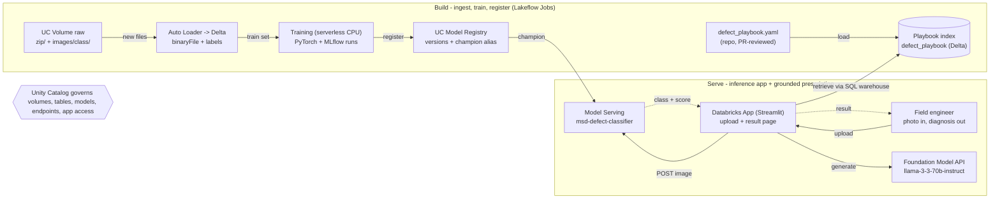
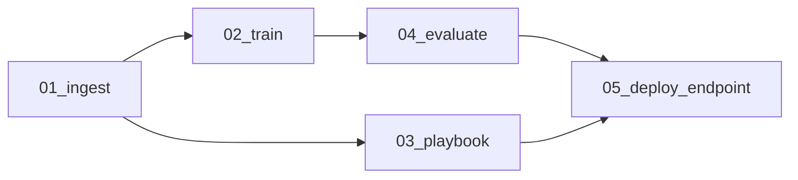
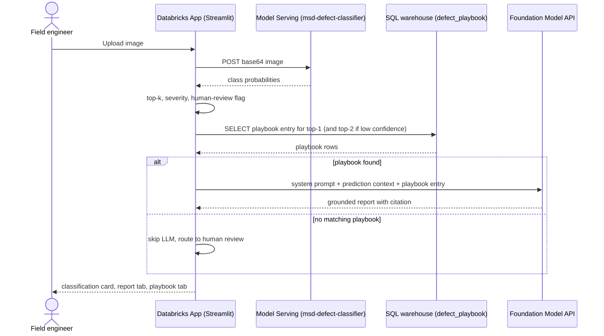
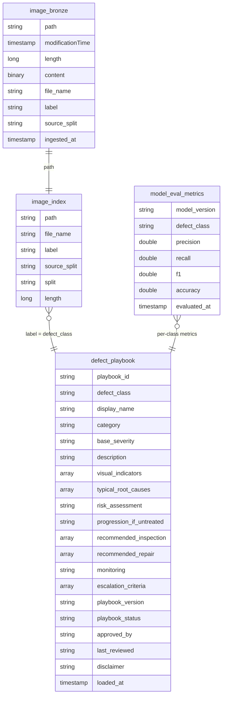

# Metal Surface Defect Diagnostics - System Architecture

This document explains how the solution and the codebase are structured: components, data flows,
data model, configuration, security and how to extend it. For setup and usage see `README.md`;
for scope and phases see `PLAN.md`; for history see `CHANGELOG.md`.

## 1. Overview

The solution follows the reference architecture **"Pipe corrosion image diagnostics"** on Azure
Databricks (serverless). It has two planes, both governed by Unity Catalog:

* **Build plane** (Lakeflow Jobs): ingest labelled images, train and register an image classifier,
  load the SME playbook index, evaluate, and publish the model to Model Serving.
* **Serve plane** (Databricks App): a field engineer uploads a photo, the app gets the predicted
  defect class and confidence from Model Serving, retrieves the matching playbook entry, and a
  Foundation Model writes a grounded prescription from that entry.

Design principle: **playbooks are written up front with integrity engineers; the LLM only
rephrases what it retrieves**, cites the source entry, and flags low confidence or no matching
playbook for human review.

## 2. System context



Legend (as in the reference): governed assets are the volume, tables, model, endpoint and app;
compute steps are the job tasks, Model Serving and the LLM; stored data is the volume and Delta
tables; people/input is the field engineer. Solid arrows are calls, dotted arrows are responses.

## 3. Components

| Component | Databricks service | Bundle resource / code | Responsibility |
| --- | --- | --- | --- |
| Raw volume | UC managed volume | `resources/msd.volume.yml` | Holds the uploaded NEU zip (`zip/`) and extracted images (`images/<class>/`) |
| Schema | UC schema | `resources/msd.schema.yml` | Container for all tables, the volume and the registered model |
| Ingest | Lakeflow Job task, serverless | `src/pipeline/01_ingest.ipynb` | Extract zip, Auto Loader `binaryFile` into `image_bronze`, label from folder name, stratified split into `image_index` |
| Train | Lakeflow Job task, serverless CPU | `src/pipeline/02_train.ipynb` | Transfer learning (MobileNetV3-Small), MLflow tracking, register to UC with `champion` alias |
| Playbook load | Lakeflow Job task | `src/pipeline/03_playbook.ipynb`, `src/playbook/defect_playbook.yaml` | Validate the YAML and overwrite the `defect_playbook` Delta table |
| Evaluate | Lakeflow Job task | `src/pipeline/04_evaluate.ipynb` | Test-set accuracy, per-class metrics, confusion matrix; write `model_eval_metrics` |
| Deploy endpoint | Lakeflow Job task | `src/pipeline/05_deploy_endpoint.ipynb` | Create or update the serving endpoint to the `champion` version |
| Classifier endpoint | Model Serving (CPU, small, scale-to-zero) | created by task 05 | REST inference: image (base64) in, class probabilities out |
| Web app | Databricks Apps (Streamlit) | `resources/msd_app.app.yml`, `src/app/` | Upload, result page, severity, human-review routing, report and playbook tabs |
| Playbook index | Delta table via SQL warehouse | `defect_playbook` | Retrieval of the SME entry for the predicted class |
| LLM | Foundation Model API (pay-per-token) | `databricks-meta-llama-3-3-70b-instruct` | Rephrase the retrieved playbook entry into the diagnostic report |

## 4. Build plane

### 4.1 Job DAG



Phase 2 ships the `ingest` and `playbook` tasks; Phase 3 adds `train`, `evaluate` and
`deploy_endpoint`. One job (`msd_training`, `resources/msd_training.job.yml`) runs the whole build. Tasks are parameterised from bundle variables
(catalog, schema, volume, model name, endpoint name), so the same code runs in `dev` and `prod`.

### 4.2 Ingestion

1. The user uploads the Kaggle zip, unchanged, to `/Volumes/<catalog>/<schema>/raw/` (root or
   `zip/`). Every `*.zip` found there is processed.
2. `01_ingest` extracts the images (not the XML annotations) from
   `NEU-DET/<split>/images/<class>/` to
   `/Volumes/<catalog>/<schema>/raw/images/<source_split>/<class>/<file>.jpg`. Files already
   present with the same size are skipped.
3. Auto Loader (`cloudFiles.format = binaryFile`, `availableNow` trigger, checkpoint in
   `raw/_checkpoints/image_bronze`) appends new images to `image_bronze`; `label` is the parent
   folder and `source_split` the grandparent folder. Re-runs only pick up new files.
4. `image_index` is rebuilt each run with a deterministic split that keeps the dataset's
   published split: Kaggle `train` (240 per class) -> `train`; Kaggle `validation` (60 per class)
   -> 30 `val` + 30 `test` per class, ordered by `xxhash64(file_name)`.
5. Checks fail the task on unexpected classes, duplicate paths or an empty split.

### 4.3 Training and registration

* Backbone: torchvision MobileNetV3-Small pretrained on ImageNet; classifier head replaced with 6
  outputs; grayscale images replicated to 3 channels, resized to 224, light augmentation (flips,
  small rotations).
* CPU-friendly: few epochs, small batch, early stopping on validation accuracy. Switching to
  serverless GPU only changes the task compute.
* MLflow logs parameters, per-epoch metrics, the confusion matrix and the model as a pyfunc
  wrapper that accepts base64 images and returns per-class probabilities, with an explicit
  signature and input example.
* The model is registered as `<catalog>.<schema>.msd_defect_classifier`; the new version gets the
  `champion` alias only if it meets the evaluation gate (test accuracy >= 90%).

### 4.4 Playbook index

`src/playbook/defect_playbook.yaml` is the source of truth (v1.0.0, status `draft`, pending SME
review). `03_playbook` validates it (exactly the six NEU classes, unique `playbook_id`, required
text and list fields non-empty, `base_severity` in Low/Medium/High) and overwrites
`defect_playbook`; validation errors fail the task so an invalid playbook never reaches the app. Content changes go through a pull request and a CHANGELOG entry.

## 5. Serve plane

### 5.1 Inference sequence



### 5.2 Severity and human review

| Condition | Severity | Human review |
| --- | --- | --- |
| top-1 confidence < threshold (default 0.70) | Low (unconfirmed) | Yes; report covers top-2 classes |
| confidence >= threshold | class base weight (Low / Medium / High) | No |
| confidence >= 0.95 and base weight High | Critical | No |
| no playbook entry or lookup failure | as above | Yes; LLM not called |

Base weights per class are in the playbook (`base_severity`), so they are reviewed together with
the content.

### 5.3 Grounded generation

* The system prompt restricts the model to the provided playbook entry, requires the fixed
  sections (Defect Summary, Risk Assessment, Recommended Inspection, Recommended Repair,
  Monitoring and Escalation) and a final `Source: <playbook_id> v<playbook_version>` line.
* The user prompt carries the prediction context (class, category, confidence, severity, review
  flag) and the playbook entry as structured text.
* Low temperature, bounded `max_tokens`. If the LLM call fails, the app shows the playbook entry
  directly so the user always gets the reviewed baseline.

### 5.4 App modules

| Module | Purpose |
| --- | --- |
| `app.py` | Streamlit layout: sidebar config, uploader, classification card, tabs |
| `lib/classifier_client.py` | Calls the serving endpoint with the Databricks SDK |
| `lib/severity.py` | Pure functions for severity and human-review rules (unit-testable) |
| `lib/playbook.py` | Reads `defect_playbook` through the SQL warehouse; YAML fallback |
| `lib/prompt.py` | Builds system and user prompts |
| `lib/llm_client.py` | Calls the Foundation Model API (OpenAI-compatible chat) |

## 6. Data model



All objects live in `poc_metal_surface_defect_diagnostics.metal_surface_defects` together with
the `raw` volume and the registered model `msd_defect_classifier`.

## 7. Codebase structure

```
metal_surface_defect_diagnostics/
  databricks.yml            # bundle name, variables, dev/prod targets
  resources/                # one file per resource: <name>.<type>.yml
    msd.schema.yml
    msd.volume.yml
    msd_training.job.yml    # phase 2-3
    msd_app.app.yml         # phase 4
  src/
    pipeline/               # job task notebooks, numbered in execution order
    playbook/               # SME playbook YAML (source of truth for grounding)
    app/                    # Streamlit app source deployed as a Databricks App
  README.md  ARCHITECTURE.md  CHANGELOG.md  PLAN.md
```

Conventions: resource keys are prefixed `msd`; all names and endpoints come from bundle variables;
notebooks read parameters from job widgets; no hard-coded catalog or schema in code.

## 8. Configuration

| Variable | Default | Used by |
| --- | --- | --- |
| `catalog` | `poc_metal_surface_defect_diagnostics` | all |
| `schema` | `metal_surface_defects` | all |
| `raw_volume` | `raw` | ingest |
| `model_name` | `msd_defect_classifier` | train, evaluate, deploy |
| `serving_endpoint` | `msd-defect-classifier` | deploy, app |
| `llm_endpoint` | `databricks-meta-llama-3-3-70b-instruct` | app |
| `warehouse_id` | `b91f5b2fb518a0b7` (`demo_serverles`) | app |
| `confidence_threshold` | `0.70` | app |

Targets: `dev` (development mode, default, job names prefixed and schedules paused) and `prod`
(production mode, shared root path, owner CAN_MANAGE, `users` CAN_VIEW).

## 9. Security and governance

* Unity Catalog governs the volume, tables, registered model, serving endpoint and app access.
* The app runs as its own service principal. The bundle grants it: `CAN_QUERY` on the classifier
  endpoint and the LLM endpoint, `CAN_USE` on the SQL warehouse, and `SELECT` on
  `defect_playbook` (plus `USE CATALOG` / `USE SCHEMA`).
* Uploaded images are processed in memory and not persisted in v1.0.
* No secrets are stored in code; all Databricks calls use the platform-provided identity.

## 10. Extending the solution

* New defect class or dataset (for example GC10-DET): add images under `images/<class>/`, add a
  playbook entry, retrain; the app reads class names from the model output and the playbook.
* GPU training: change the train task compute; no code change.
* Retrieval at scale: replace the exact-match lookup with a Vector Search index over playbook
  chunks when playbooks become long or multi-document.
* Feedback loop: persist uploads and engineer verdicts to a Delta table for relabelling.

## 11. Known limitations

* NEU images are steel strip defects, not in-service pipeline photos; the pipeline-corrosion
  mapping is illustrative.
* The playbook is POC content and requires integrity-engineer sign-off before real use.
* dev and prod share one workspace and catalog in this POC.
