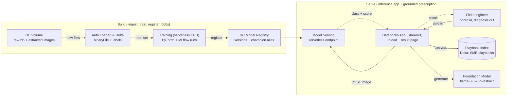

# Metal Surface Defect Diagnostics - Implementation Plan

Status: Approved (v1.0.0 scope) - 2026-11-16. Phase 1 (foundation) released in 1.1.0. Phase 2 (data) released in 1.2.0. Phase 3 (model) released in 1.3.0. Phase 4 (app) released in 1.4.0; first prod deployment and review-flow fix in 1.4.1.

## 1. Goal

Proof of concept for **pipe corrosion image diagnostics (predictive and prescriptive)**. A user uploads an image of a metal surface in a Streamlit app. The app:

1. Calls an image classification model (Model Serving) to predict the defect type and confidence.
2. Derives a severity level and flags low-confidence results for human review.
3. Retrieves a **pre-generated, reviewed playbook entry** (standard analysis and recommendations) for the predicted defect class.
4. Calls an LLM that uses the playbook entry as its grounding baseline to produce a short diagnostic report (summary, risk, inspection, repair, monitoring), without inventing facts outside the playbook.

## 2. Key decisions

| Area | Decision |
| --- | --- |
| Dataset | NEU Surface Defect Database (Kaggle `kaustubhdikshit/neu-surface-defect-database`), 6 classes, 200x200 grayscale |
| Data ingestion | User uploads the dataset zip manually to a UC Volume; a job step extracts it, then Auto Loader (`binaryFile`) incrementally loads images into a Delta table with labels derived from folder names |
| Model | Lightweight transfer learning on CPU (MobileNetV3-Small, ResNet18 fallback), PyTorch + torchvision. The reference architecture uses serverless GPU; CPU was chosen for simplicity, and the training notebook is written so switching to GPU is a compute change only |
| Tracking / registry | MLflow, registered in Unity Catalog as `msd_defect_classifier` with alias `champion` |
| Serving | Databricks Model Serving, CPU, small, scale-to-zero, endpoint `msd-defect-classifier` (`msd-defect-classifier-dev` in dev) |
| LLM | `databricks-meta-llama-3-3-70b-instruct` (configurable bundle variable) |
| Grounding | SME playbooks versioned as YAML in the repo, loaded into a Delta "playbook index" table, retrieved by class and injected into the prompt; the report cites the source playbook entry |
| App identity | The app calls Model Serving, the SQL warehouse and the Foundation Model API with its own service principal |
| App | Streamlit as a Databricks App |
| Packaging | Declarative Automation Bundle (DAB), targets `dev` and `prod` |
| Repository | `github.com/jose-alberto-salazar-jimenez/databricks_demos`, folder `e2e_industry_solutions/metal_surface_defect_diagnostics` |
| UC location | Catalog `poc_metal_surface_defect_diagnostics` (prerequisite), schema `metal_surface_defects` (bundle-owned) |
| SQL warehouse | `demo_serverles` (serverless) for app playbook lookups |
| Docs | README.md, ARCHITECTURE.md (Mermaid diagrams), CHANGELOG.md (Keep a Changelog, SemVer), PLAN.md |

## 3. Target architecture

Aligned with the reference architecture "Pipe corrosion image diagnostics" (Azure Databricks, serverless). Two planes, both governed by Unity Catalog (volumes, tables, models, endpoints, app access).



Build flow: upload to UC Volume, Auto Loader into `image_bronze` (binary content + label), stratified split into `image_index`, fine-tune on serverless CPU with MLflow tracking, register to UC and promote with the `champion` alias, deploy or update the serving endpoint.

Serve flow: the app posts the image to Model Serving and receives class probabilities, computes severity, retrieves the matching playbook entry, and asks the foundation model to write the prescription from that entry only, citing the playbook id and version. Low confidence or no matching playbook routes to human review.

The same diagram (Mermaid) and a description of every component are in ARCHITECTURE.md.

## 3a. Defect classes and pipeline-corrosion mapping

NEU contains hot-rolled steel strip defects. For this POC each class is interpreted in a pipeline-integrity context:

| NEU class | Category (pipeline context) | Base severity weight |
| --- | --- | --- |
| crazing | Surface cracking network / stress-related | High |
| inclusion | Material / manufacturing imperfection | Medium |
| patches | Corrosion / oxidation area | Medium |
| pitted_surface | Pitting corrosion | High |
| rolled-in_scale | Mill scale / surface contamination | Low |
| scratches | Mechanical surface damage | Low |

This mapping is a documented assumption, not an engineering standard.

## 4. Severity logic

Severity combines the class base weight and model confidence:

* Confidence below the threshold (default 70%): severity `Low` (unconfirmed) and **human review required**; the report covers the top-2 candidate classes.
* Confidence above the threshold: severity is the class base weight, raised one level (up to `Critical`) when confidence is at least 95% and the base weight is High.

Thresholds are bundle variables / app environment settings.

Human review is also triggered when no playbook entry matches the predicted class (or the playbook lookup fails); in that case the LLM is not called and the app shows the prediction only.

## 5. Repository layout

```
e2e_industry_solutions/metal_surface_defect_diagnostics/
  databricks.yml                 # bundle, variables, targets
  resources/
    msd.schema.yml               # bundle-owned schema
    msd.volume.yml               # raw data volume
    msd.experiment.yml           # MLflow experiment per target                                (phase 3)
    msd_training.job.yml         # ingest -> train -> evaluate -> deploy endpoint, + playbook  (phase 2-3)
    msd_app.app.yml              # Streamlit Databricks App                                    (phase 4)
  src/
    pipeline/
      01_ingest.ipynb            # unzip in volume, Auto Loader binaryFile -> image_bronze, stratified split -> image_index
      02_train.ipynb             # transfer learning, MLflow logging, UC registration
      03_playbook.ipynb          # load reviewed playbook YAML into Delta
      04_evaluate.ipynb          # test metrics, confusion matrix, calibration
      05_deploy_endpoint.ipynb   # create/update serving endpoint for champion model
    playbook/
      defect_playbook.yaml       # per-class standard analysis and recommendations
    app/
      app.py                     # Streamlit UI
      app.yaml                   # app command and env
      requirements.txt
      lib/
        classifier_client.py     # calls model serving endpoint
        playbook.py              # SQL helper + playbook lookup (Delta via SQL warehouse)
        severity.py              # severity and human-review logic
        prompt.py                # grounded prompt construction
        llm_client.py            # calls Foundation Model API
        report_pdf.py            # downloadable PDF report
        feedback.py              # ratings, review cases, expert reviews
      tests/                     # unit tests (pytest)
  README.md
  ARCHITECTURE.md
  CHANGELOG.md
  PLAN.md
```

## 6. Data model (Unity Catalog)

| Object | Type | Purpose |
| --- | --- | --- |
| `raw` | Volume | Uploaded dataset zip (root or `zip/`), extracted images (`images/<source_split>/<class>/`), Auto Loader checkpoint (`_checkpoints/`) |
| `image_bronze` | Delta table | Auto Loader output: path, modificationTime, length, content (binary), file_name, label, source_split, ingested_at |
| `image_index` | Delta table | path, file_name, label, source_split, split (train/val/test), length |
| `defect_playbook` | Delta table (playbook index) | One row per class: playbook_id, category, description, root causes, risk, inspection, repair, monitoring, escalation, playbook_version, approved_by |
| `model_eval_metrics` | Delta table | Accuracy, per-class precision/recall/F1 per model version |
| `diagnosis_feedback` | Delta table | App ratings, review requests (open cases) and expert reviews, linked by `case_id`, with a snapshot of the prediction and report |
| `msd_defect_classifier` | UC model | Registered classifier, alias `champion` |

## 7. Grounding approach

1. Playbook content is drafted once (LLM-assisted), reviewed by a human, and frozen in `defect_playbook.yaml` with a version number. Changes go through PRs and CHANGELOG entries.
2. At inference the app retrieves the playbook entry for the predicted class (and the runner-up when confidence is low).
3. The system prompt instructs the LLM to only summarise and adapt the playbook content to the prediction context (class, confidence, severity), to state uncertainty explicitly, and not to add facts not present in the playbook.
4. Low temperature and a fixed output structure (Defect Summary, Risk Assessment, Recommended Inspection, Recommended Repair, Monitoring and Escalation).
5. The report ends with a source citation (playbook id and version), and the raw playbook entry is shown in a separate "Playbook reference" tab for traceability.
6. If confidence is below threshold or no playbook matches, the app routes to human review (banner plus explicit statement in the report).

## 8. App UI

The first version followed the provided mockup (sidebar, wide layout). After user testing in Phase 4 it became mobile-first:

* Phone-width single column (480 px) with an app bar; no sidebar (config and disclaimer in "About this app").
* Top-level tabs: **Diagnose** and **Review cases**.
* Diagnose: one image per analysis (upload or camera; JPG, PNG, BMP up to 10 MB), preview, **Analyze image**, then the result card (defect, category, alternative when unconfirmed, severity, confidence and review chips, top-3 bars), an "Unconfirmed result" banner when review is required, tabs **Report / Playbook / Model**, **Download PDF report**, a thumbs rating, and a **Send to expert review** section (optional suspected class and note; requests only, no verdicts). **New analysis** resets.
* Review cases: Open and Reviewed lists; each open case shows image, model output and report next to the review form (the only place a verdict is recorded); reviewed cases show the verdict, corrected class, reviewer severity, reviewer and notes.

## 9. Phases, build steps and acceptance criteria

| Phase | # | Step | Done when |
| --- | --- | --- | --- |
| 1 Foundation | 1 | Git folder + bundle skeleton, variables, targets | `bundle validate --strict --target dev` passes |
| 1 Foundation | 2 | Schema and volume resources | Schema and `raw` volume exist after deploy |
| 1 Foundation | 9 | Docs | README, ARCHITECTURE (with diagrams), CHANGELOG 1.0.0 + Unreleased, PLAN |
| 2 Data | 3 | Ingest notebook (Auto Loader) | `image_bronze` and `image_index` have 1,800 rows, 300 per class; split keeps the Kaggle split (240 train, 30 val, 30 test per class); re-running loads no duplicates and changes no split |
| 2 Data | 5 | Playbook YAML + notebook | `defect_playbook` has 6 rows, one per class, no null key fields |
| 3 Model | 4 | Train notebook | Model registered in UC with `champion` alias; validation accuracy reported |
| 3 Model | 6 | Evaluate notebook | Test metrics written; target test accuracy >= 90% |
| 3 Model | 7 | Serving endpoint | Endpoint READY and returns probabilities for a sample image |
| 4 App | 8 | Streamlit app | App deployed; upload returns classification, report and playbook tabs |
| 4 App | 10 | End-to-end test | Sample test image per class produces a grounded report consistent with its playbook entry |
| 4 App | 11 | Mobile layout, PDF, feedback | Phone-width layout; PDF downloads; ratings and expert reviews land in `diagnosis_feedback` with an image copy in `raw/reviews/` |
| 4 App | 12 | Review cases | Unconfirmed results open a case automatically; the case appears under Open and moves to Reviewed after an expert review |

## 10. Prerequisites (user)

* Catalog `poc_metal_surface_defect_diagnostics` exists (done).
* Git folder `databricks_demos` cloned in the workspace (done).
* After the first deploy: download the NEU dataset zip from Kaggle and upload it to `/Volumes/poc_metal_surface_defect_diagnostics/metal_surface_defects/raw/zip/`.
* Access to the Foundation Model API endpoint `databricks-meta-llama-3-3-70b-instruct` (verified READY) and SQL warehouse `demo_serverles` (verified).

## 11. Assumptions and limitations

* NEU images are steel strip defects, not in-service pipeline images; the corrosion mapping is illustrative.
* CPU training keeps setup simple but is slower; image size and epochs are kept small.
* The playbook is POC content and must be reviewed by integrity engineers before real use.
* No user authentication beyond Databricks App workspace auth and no reviewer role: any app user can submit an expert review.
* Uploaded images are persisted only for review cases and expert reviews (`raw/reviews/`).
* dev and prod share one workspace and catalog in this POC.

## 11a. Check early (from the reference architecture)

* Serverless GPU availability varies by Azure region (relevant only if training moves to GPU).
* Databricks Apps require a Premium workspace.
* Label quality and class balance drive accuracy (NEU is balanced: 300 images per class).
* Playbook content needs engineer sign-off before go-live.

## 12. Versioning

* `CHANGELOG.md` follows Keep a Changelog and Semantic Versioning.
* Initial release `1.0.0`. New work goes under `[Unreleased]` and is promoted to a new version when the PR is merged.
