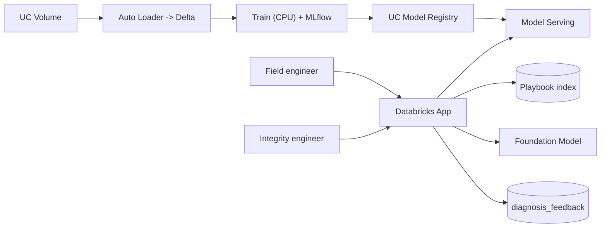

# Metal Surface Defect Diagnostics

Pipe corrosion image diagnostics, **predictive and prescriptive**, on Databricks.

A field engineer uploads a photo of a metal surface to a Streamlit Databricks App. The app:

1. classifies the defect with an image model served on Model Serving,
2. assigns a severity and routes low-confidence results to human review,
3. retrieves the matching, engineer-reviewed **defect playbook** entry, and
4. asks a Foundation Model to write a short diagnostic report (summary, risk, inspection, repair,
   monitoring) **from that playbook entry only**, citing the source.

Pre-written playbooks give the LLM a reviewed baseline, so it rephrases instead of inventing
recommendations.

The report can be downloaded as a PDF. Unconfirmed results open an **expert review case**; an
integrity engineer confirms or corrects it in the **Review cases** tab, and every verdict is
stored with the image as a labelled example.

> Status: Phase 1 (foundation) released in 1.1.0; Phase 2 (data and playbook) released in 1.2.0; Phase 3 (model) released in 1.3.0; Phase 4 (app) released in 1.4.0. See `PLAN.md`.

## Architecture at a glance



Details, diagrams and component descriptions: [ARCHITECTURE.md](ARCHITECTURE.md).

## Dataset

[NEU Surface Defect Database](https://www.kaggle.com/datasets/kaustubhdikshit/neu-surface-defect-database):
1,800 grayscale 200x200 images of hot-rolled steel, 300 per class.

| Class | Pipeline-context category |
| --- | --- |
| crazing | Surface cracking network / stress-related |
| inclusion | Material / manufacturing imperfection |
| patches | Corrosion / oxidation area |
| pitted_surface | Pitting corrosion |
| rolled-in_scale | Mill scale / surface contamination |
| scratches | Mechanical surface damage |

The pipeline-context mapping is an illustrative POC assumption.

## Tech stack

Unity Catalog (volume, tables, model), Auto Loader, Lakeflow Jobs (serverless), PyTorch +
torchvision, MLflow, Model Serving, Foundation Model API
(`databricks-meta-llama-3-3-70b-instruct`), Databricks Apps (Streamlit), Declarative
Automation Bundles.

## Repository layout

```
metal_surface_defect_diagnostics/
  databricks.yml     # bundle definition and variables
  resources/         # schema, volume, job, app
  src/pipeline/      # ingest, train, playbook, evaluate, deploy notebooks
  src/playbook/      # SME defect playbook (YAML)
  src/app/           # Streamlit app
  README.md  ARCHITECTURE.md  CHANGELOG.md  PLAN.md
```

## Prerequisites

* Premium Azure Databricks workspace with Unity Catalog, serverless compute, Model Serving and
  Databricks Apps enabled.
* Catalog `poc_metal_surface_defect_diagnostics` (or another catalog you can create schemas in;
  override with `--var catalog=<name>`).
* Access to the Foundation Model endpoint `databricks-meta-llama-3-3-70b-instruct` and a SQL
  warehouse (default `demo_serverles`; override with `--var warehouse_id=<id>`).
* Databricks CLI (web terminal or local) or the workspace bundle UI.

## Getting started

Run every `databricks bundle` command from this folder (the bundle root). From another folder the
CLI may pick up a different bundle and its workspace (for example a 403 "Invalid access token"
from another host).

1. Validate and deploy the foundation (schema, volume, experiment, job):

   ```
   databricks bundle validate --strict --target dev
   databricks bundle deploy --target dev
   ```

   On a fresh target this first deploy ends with `cannot create resources.apps.msd_app ...
   defect_playbook does not exist`. That is expected: the app's tables and serving endpoint are
   created by the build job (step 3), not by the bundle, and the Apps API checks that they exist.
   Everything else is created; the app is added by the deploy in step 4.

2. Download the NEU zip from Kaggle and upload it, as is, to the `raw` volume (root or `zip/`)
   via Catalog Explorer > volume > Upload, or the Files API. The schema name depends on the target:

   | Target | Volume path |
   | --- | --- |
   | dev | `/Volumes/poc_metal_surface_defect_diagnostics/dev_<your_user>_metal_surface_defects/raw/` |
   | prod | `/Volumes/poc_metal_surface_defect_diagnostics/metal_surface_defects/raw/` |

   Development mode prefixes the schema with `dev_<user>_` so personal deployments do not collide
   with prod. The Kaggle archive contains `NEU-DET/{train,validation}/images/<class>/*.jpg`
   (1,800 images, 300 per class) plus Pascal VOC XML annotations, which this POC does not use.

3. Deploy again (to pick up the job) and run the build job:

   ```
   databricks bundle deploy --target dev
   databricks bundle run msd_training --target dev
   ```

   Tasks: `ingest` (extract zip, Auto Loader into `image_bronze`, split into `image_index`:
   240 train / 30 val / 30 test per class), `playbook` (validate the YAML and load
   `defect_playbook`), `train` (CPU transfer learning, about 5 minutes of training plus the
   isolated serving-readiness check, registers a new model version), `evaluate` (test metrics into
   `model_eval_metrics`, sets `@champion` at test accuracy >= 90%) and `deploy_endpoint`
   (creates or updates the serving endpoint for `@champion`; the first creation takes about 15
   minutes). Endpoint names: `msd-defect-classifier-dev` (dev), `msd-defect-classifier` (prod).

4. Deploy again (to attach the app resources) and start the app:

   ```
   databricks bundle deploy --target dev
   databricks bundle run msd_app --target dev
   ```

   App names: `msd-app-dev` (dev), `msd-diagnostics` (prod). If an app with that name already
   exists outside the bundle, link it first with
   `databricks bundle deployment bind msd_app <app-name> --target dev`.

   Creating an app needs your own user credentials (CLI or web terminal). With a delegated or
   agent token the Apps API rejects the create with `Invalid delegation claim present in Ctx`;
   updates and code deployments of an existing app work.

5. Open the app URL (it works on a phone too) and, on **Diagnose**, upload or take one photo
   (for example from `raw/images/validation/pitted_surface/`), press **Analyze image**, and review
   the result card and the Report / Playbook / Model tabs. Then:

   * **Download PDF report** saves the full report.
   * Thumbs up / down rates the diagnosis.
   * **Send to expert review** puts the result in the review queue, optionally with what you
     think the defect is and a note. Results below 70% confidence go to the queue automatically.
   * **Review cases** lists open and reviewed cases. Integrity engineers open a case to see its
     image and report and record the verdict (confirm, correct the class, or inconclusive),
     which moves it to Reviewed.

   Feedback is stored in `diagnosis_feedback` and reviewed images in `raw/reviews/<date>/`.

6. Run the app unit tests (from a copy outside the workspace folder, since workspace files do not
   accept `__pycache__`): `pip install -r src/app/requirements.txt pytest`, then `pytest src/app/tests`.

Prod (`--target prod`) follows the same steps with the prod volume path. Deploy prod from `main`
after the phase is merged. Later releases need only `bundle deploy --target prod` (plus
`bundle run msd_app --target prod` for app code changes, and `bundle run msd_training` for
retraining).

## Configuration

All names are bundle variables in `databricks.yml` (catalog, schema, volume, model name, serving
endpoint, LLM endpoint, warehouse, confidence threshold, app name). The app receives them as
environment variables from its resources. See ARCHITECTURE.md section 8.

## Updating the playbook

Edit `src/playbook/defect_playbook.yaml`, bump `playbook_version`, add a CHANGELOG entry, open a
PR for engineer review, then re-run the job (the playbook task reloads the table).

## Contributing and versioning

Work on a branch, add entries under `[Unreleased]` in [CHANGELOG.md](CHANGELOG.md), and promote
them to a new version when the PR is merged (Semantic Versioning).

## Disclaimer

This is a proof of concept. NEU images are steel strip defects, not in-service pipeline images,
and the playbook content must be reviewed by qualified integrity engineers before any
operational use.
