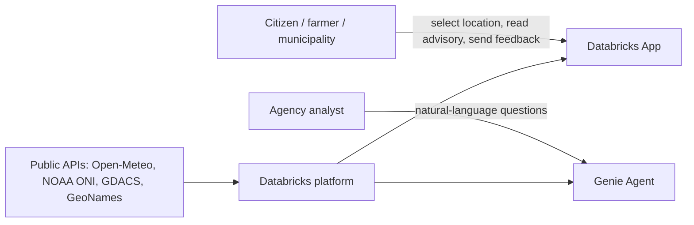
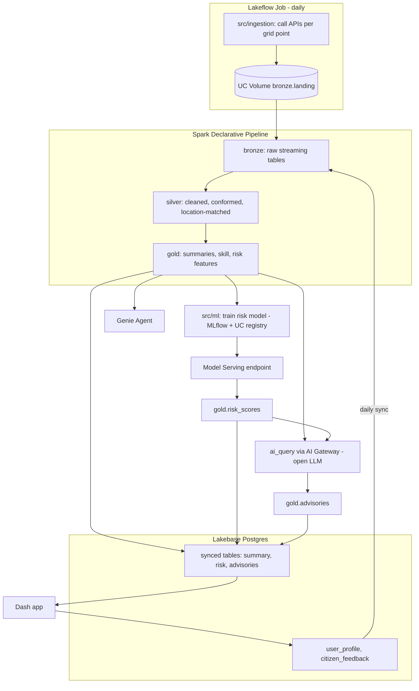
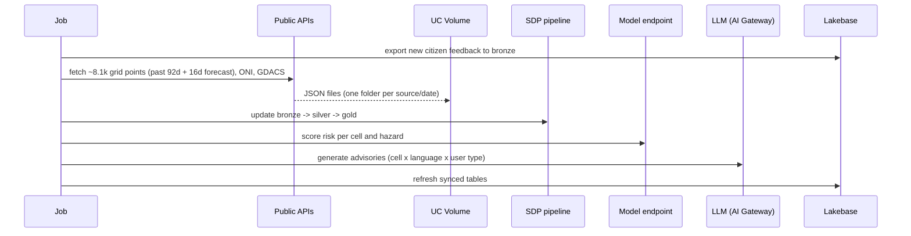
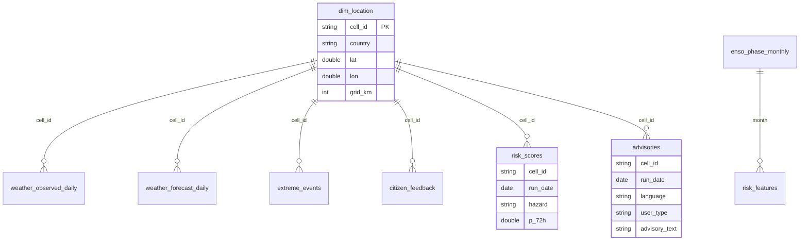
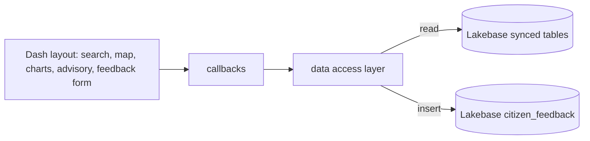

# System Architecture

How the solution and the codebase are structured. Diagrams use Mermaid (rendered by GitHub).
Status: target design for v1.x; sections are updated as components are built.

## 1. Context

## 2. Logical architecture

## 3. Daily run sequence

One Lakeflow Job, scheduled once per day (early morning, UTC-5):

Retraining runs weekly as a separate task once enough feedback and events accumulate.

## 4. Data model (Unity Catalog)

Catalog `weather_forecast_warnings_comms`, schemas `bronze`, `silver`, `gold`.

* Grain: one row per grid cell per day (forecasts: per cell, run date, target date).
* `cell_id`: deterministic id from rounded lat/lon and grid size (20 km PE/CO/EC, 10 km CR/PA).
* Towns (GeoNames) map to their nearest `cell_id`; any coordinate resolves the same way.
* Governance: comments on all tables, tags (`domain`, `pii`), column mask on feedback
  contact fields, app service principal has SELECT on gold only.

## 5. Codebase structure

| Path | Responsibility | Runs on |
| --- | --- | --- |
| `databricks.yml` | Bundle root: variables (catalog, schemas), dev/prod targets | CLI |
| `resources/*.yml` | Job, pipeline, serving endpoint, app, Lakebase definitions | Bundle deploy |
| `src/ingestion/` | Grid generation, API calls with retry/backoff, writes to volume | Serverless job |
| `src/pipeline/` | SDP tables and expectations, bronze to gold | Serverless pipeline |
| `src/ml/` | Features, training, registration, batch scoring, advisory prompts | Serverless job |
| `src/app/` | Dash pages, callbacks, Lakebase data access | Databricks Apps |
| `evidence/` | Text outputs that prove each stage ran | Committed manually |

Conventions: lowercase snake_case names; configuration through bundle variables, never
hard-coded workspace ids; one module per concern; files kept under 9,000 characters.

## 6. Application design

* Stateless app instances behind Databricks Apps; scales by adding instances.
* Reads hit Lakebase only (no SQL warehouse on the request path).
* Auth: app service principal with OAuth tokens to Lakebase; no secrets in code.
* Language and user type come from the user profile or the UI selector.

## 7. Environments and deployment

| Target | Catalog | Purpose |
| --- | --- | --- |
| dev | `weather_forecast_warnings_comms` (dev prefix on resources) | Development, per-user deploys |
| prod | `weather_forecast_warnings_comms` | Scheduled daily run, shared app |

Flow: feature branch -> PR (bundle validate in CI) -> merge to main -> deploy prod.

## 8. Non-functional design

* Cost: daily batch, serverless compute, open low-cost LLM, cached advisories.
* Limits: ~8.1k points/day within Open-Meteo free tier (10k calls/day).
* Reliability: idempotent daily loads keyed by run date; failed days can be re-run.
* Quality: SDP expectations (coordinates, ranges, nulls); model compared to rule baseline.
* LLM safety: values injected from gold, no invented numbers or causes, sampled evaluation.
