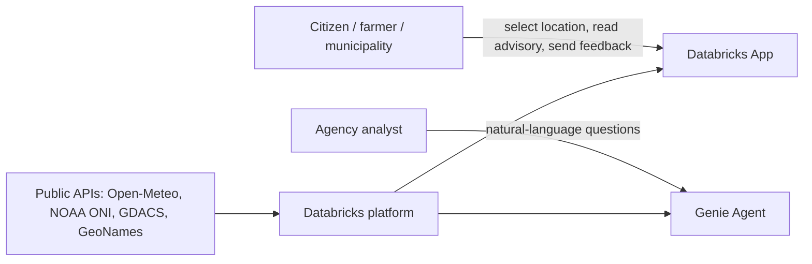
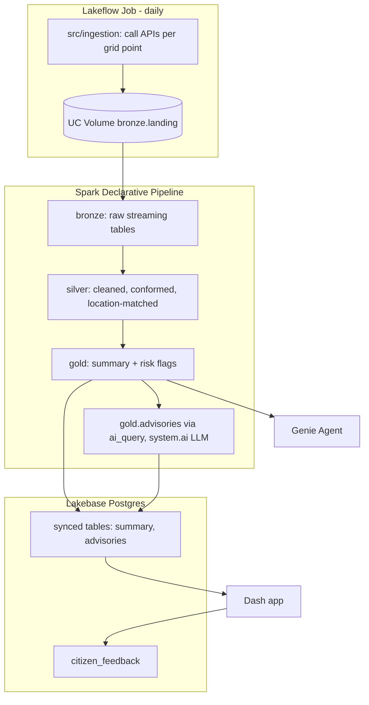
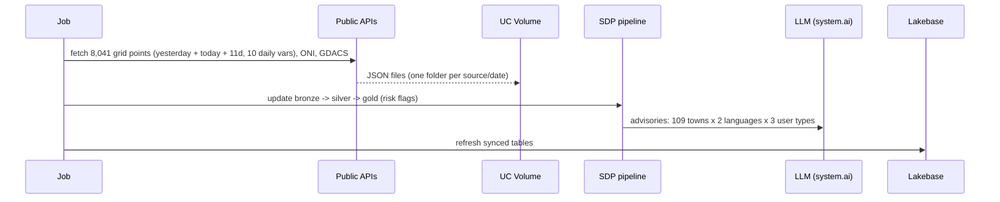
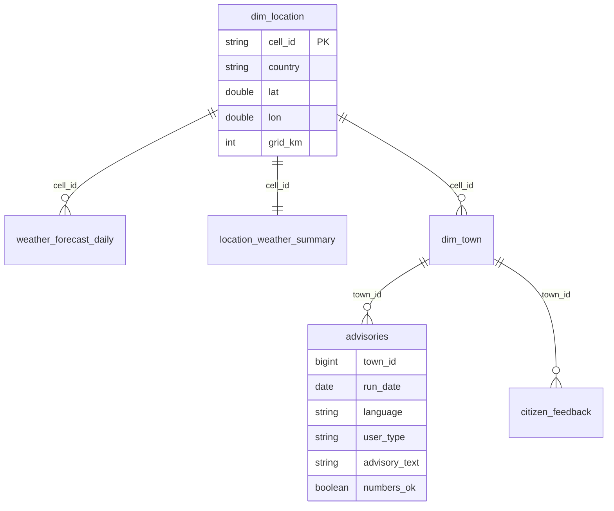
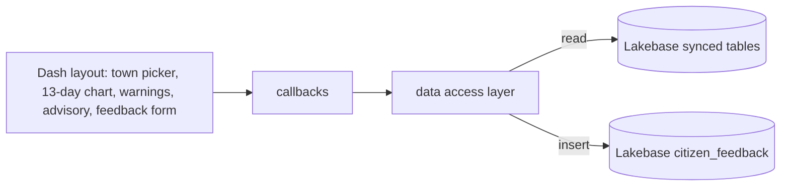

# System Architecture

How the solution and the codebase are structured. Diagrams use Mermaid (rendered by GitHub).
Status: PoC design (PLAN.md); deferred parts are listed in PLAN.md section 7.

## 1. Context

## 2. Logical architecture

## 3. Daily run sequence

One Lakeflow Job, scheduled once per day (early morning, UTC-5):

## 4. Data model (Unity Catalog)

Catalog `weather_forecast_warnings_comms`, schemas `bronze`, `silver`, `gold`.

* Grain: one row per grid cell per day (forecasts: per cell, run date, target date).
* `cell_id`: deterministic id from rounded lat/lon and grid size (20 km PE/CO/EC, 10 km CR/PA).
* Towns (GeoNames, 109 main towns) map to their nearest `cell_id`.
* Governance: comments on all tables, tags (`domain`, `pii`), app service principal has
  SELECT on gold only (column masks: roadmap).

### Data sources and lineage

Every landed JSONL row carries `data_source`, `source_url`, `source_model` and `request_mode`;
raw text files (ENSO, GeoNames) get `data_source` from their folder in bronze.
`reference/data_sources/sources.jsonl` (from `source_registry.py`) becomes `dim_data_source`
(provider, product, license, resolution). Silver and gold keep `data_source` and `request_mode`
so each value shows where it came from.

| data_source | request_mode | Landing folder | Used for |
| --- | --- | --- | --- |
| `open_meteo_forecast` | `daily` | `open_meteo_forecast/run_date=` | today + 11 days; yesterday builds the past 11 days |
| `gdacs` | `daily` | `gdacs/` | extreme events |
| `noaa_cpc_oni`, `geonames`, `natural_earth(_lakes)` | - | `enso_oni/`, `geonames/`, `reference/` | ENSO phase, towns, land grid |

## 5. Codebase structure

| Path | Responsibility | Runs on |
| --- | --- | --- |
| `databricks.yml` | Bundle root: variables (catalog, schemas), dev/prod targets | CLI |
| `resources/*.yml` | Job, pipeline, volume, app, Lakebase definitions | Bundle deploy |
| `src/ingestion/` | Notebook `ingest_sources.py` (daily); modules `source_registry.py` (sources, licenses, tags), `ingest_lib.py` (retry, rate limiter, Open-Meteo), `context_lib.py` (grid, GeoNames, ENSO, GDACS) | Serverless job |
| `src/pipeline/` | SDP SQL: `bronze/raw_sources.sql` (all raw streaming tables), one file per dataset in `silver/`, `gold/`; pipeline default schema is bronze, silver/gold names are schema-qualified via pipeline configuration | Serverless pipeline |
| `src/app/` | One-page Dash app, Lakebase reads and feedback writes | Databricks Apps |
| `evidence/` | Text outputs that prove each stage ran | Committed manually |

Conventions: lowercase snake_case names; configuration through bundle variables, never
hard-coded workspace ids; one module per concern; files kept under 9,000 characters.

## 6. Application design

* Stateless app instances behind Databricks Apps; scales by adding instances.
* Reads hit Lakebase only (no SQL warehouse on the request path).
* Auth: app service principal with OAuth tokens to Lakebase; no secrets in code.
* Language and user type come from UI selectors; only `numbers_ok` advisories are shown.

## 7. Environments and deployment

| Target | Catalog | Purpose |
| --- | --- | --- |
| dev | `weather_forecast_warnings_comms_dev` (jobs prefixed `[dev <user>]`, schedules paused) | Development and tests |
| prod | `weather_forecast_warnings_comms` (schedule via `refresh_pause_status`) | Scheduled daily run, shared app |

Both targets run in one workspace; separate catalogs keep tables, volumes and pipelines apart.
A real customer deployment would put prod in its own workspace, deployed by a service principal.

Flow: feature branch -> PR (bundle validate in CI) -> merge to main -> deploy prod.

## 8. Non-functional design

* Cost: daily batch, serverless compute, open low-cost LLM, cached advisories.
* Limits: 8,041 points/day within Open-Meteo free tier (10k/day, 5k/hour, 600/min, 300k/month).
  One location = 1 call only while <=10 variables and <=14 days, so the request stays at that size;
  the ingestion notebook rate-limits to 550/min and 4,800/hour (full grid ~1h45m) and stops a
  run whose weighted calls would exceed `daily_call_budget` (9,500).
* Horizon +/- 11 days: each daily run stores yesterday + today + 11 days ahead; the past 11 days
  build up from stored runs (observed-like `yesterday` values).
* Reliability: idempotent daily loads keyed by run date; failed days can be re-run.
* Quality: SDP expectations (coordinates, ranges, nulls, advisory numbers).
* LLM safety: values injected from gold; `numbers_ok` rejects other numbers; sample reviewed.
